<p align="center">
  
</p>

<h3 align="center">Ajan tabanlı işlemler için geliştirme çatısı.</h3>

<p align="center">
  Piyasayı araştıran, yatırım tezini oluşturan ve belirlediğiniz izinler dahilinde<br>
  kendi aracı kurum hesabınızda işlem yapan açık kaynaklı yapay zekâ ajanları.
</p>

<p align="center">
  <a href="https://langalpha.ai"><strong>LangAlpha'yı Dene ↗</strong></a> ·
  <a href="https://docs.langalpha.ai"><strong>Belgeler ↗</strong></a> ·
  <a href="#başlangıç"><strong>Başlangıç</strong></a> ·
  <a href="#ajan-tabanlı-işlem"><strong>Ajan tabanlı işlem</strong></a> ·
  <a href="#harness-tasarımı"><strong>Harness tasarımı</strong></a> ·
  <a href="#tam-yığın-mimarisi"><strong>Tam yığın mimarisi</strong></a> ·
  <a href="#güvenlik"><strong>Güvenlik</strong></a>
  <br />
  <a href="README.md">English</a> · <a href="README.zh-CN.md">简体中文</a> · <a href="README.ja-JP.md">日本語</a> · Türkçe
</p>

<p align="center">
  <a href="https://github.com/ginlix-ai/langalpha/stargazers"></a>
  
  
  <a href="https://github.com/langchain-ai/langchain"></a>
  <a href="https://docs.langalpha.ai"></a>
  <a href="https://github.com/ginlix-ai/langalpha/releases"></a>
</p>

<p align="center">
  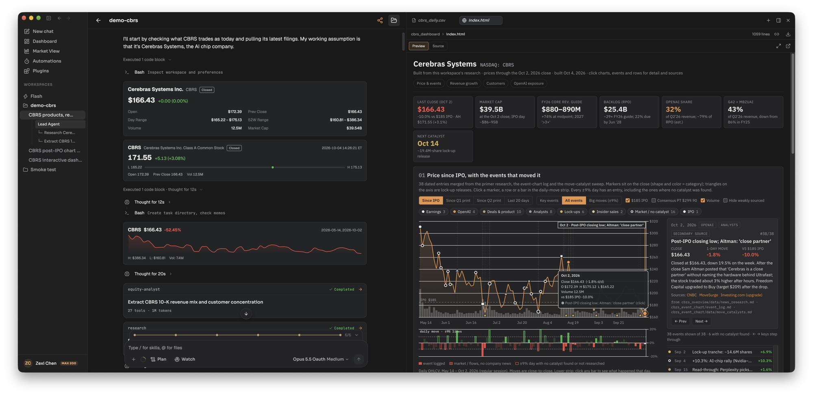
</p>

## Neden LangAlpha

Çoğu yapay zekâ finans aracı yalnızca soruları yanıtlar. Biz yatırım araştırmasının Bayesyen olduğuna inanıyoruz: bir tez ve onu neyin çürüteceğini yazarsınız; ardından her bilanço açıklaması, resmi bildirim ve fiyat hareketi inancınızı — ve onunla birlikte pozisyonunuzu — güçlendirir ya da zayıflatır. Bu döngü haftalar veya aylar sürer ve hiçbir tekil istem bunu yakalayamaz.

Kodlama ajanları, kod için tasarlanmış bir çatıya (harness) kavuştuklarında gerçekten iyi hale geldiler: kalıcı bir kod tabanı, her commit'in bir öncekinin üzerine inşa edildiği bir yapı ve modelin etrafındaki araçlar, bellek ve çalışma zamanı. LangAlpha bu çatıyı piyasalara taşıyor; "vibe coding"den "vibe investing"e. Her modelle çalışır, bu nedenle çıkan her daha iyi model onu da daha iyi kılar. İki temel ilke onu şekillendirir:

- **Bir işlem bir araç çağrısı değil, bir döngüdür.** Tez bir çalışma alanında yaşar; araştırma, pozisyon büyüklüğü, emir ve ardından gelen takip her seferinde teze yeni kanıtlar besler.
- **Özerklik, sizin çizdiğiniz bir sınıra ihtiyaç duyar.** Ajanlar yalnızca verdiğiniz izinler dahilinde hareket eder ve her emir yönetilen tek bir yoldan geçer.

<p align="center">
  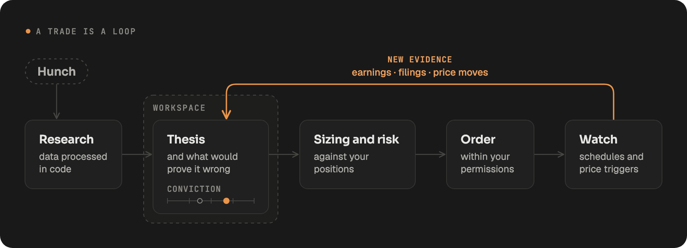
</p>

## Öne çıkan özellikler

Bu örneklerin çoğu Cerebras (CBRS) üzerine tek bir çalışma alanından alınmıştır. İlk sorudan Slack'e gönderilen başlangıç raporuna kadar nasıl çalıştığını [bu paylaşılan sohbette](https://app.langalpha.ai/s/z7rvgK3P9vZN) görebilirsiniz.

### 🔎 Bir ajan ekibiyle araştırma yapın

Bir soru sorduğunuzda LangAlpha bunu paralel çalışan analistlere böler; bu analistler resmi bildirimleri okur, fiyat, opsiyon ve makro verilerini çeker ve hesaplamaları kod içinde yürütür. Çalışma sırasında yönlerini değiştirmek için istediğiniz zaman takip mesajı gönderebilirsiniz. CBRS örneğinde çalışma, Cerebras'ın ne sattığını, ne kadar hızlı büyüdüğünü ve müşterilerinin kim olduğunu özetleyen [bir HTML rehberiyle](https://app.langalpha.ai/a/lep06ly8Qjfa) sonuçlandı.

<p align="center">
  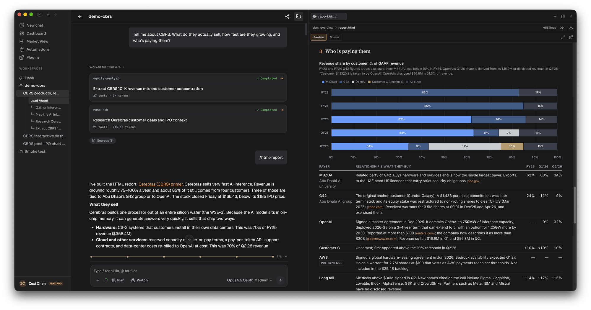
  <br />
  <sub><b>Alt ajanlar</b>: dört analist lider ajanın altında soruyu inceler, her kart araç ve token sayısını gösterir; tek bir <code>/html-report</code> komutu bulgularını sağdaki rehbere dönüştürür</sub>
</p>

### 🗂️ Her fikri bir çalışma alanında saklayın

Her tez, sektör veya portföy için ayrı bir çalışma alanı. Dosyalar, sohbetler ve ajanın kendi notları ertesi gün de yerindedir; böylece her oturum sıfırdan başlamak yerine bir öncekinin üzerine inşa edilir.

> *"Bu çalışma alanında şu ana kadar bulduklarımızdan CBRS üzerine etkileşimli bir pano oluştur: önemli olaylarla birlikte fiyat grafiği, gelir büyümesi, müşteri yoğunlaşması ve OpenAI'a ne kadar bağlı olduğu. Üzerinde tıklayıp gezinebilmek istiyorum."*

Yeni bir sohbet dizisi, önceki dizilerin çalışma alanına bıraktığı araştırma ve dosyalardan bunu üretir: [etkileşimli olarak deneyebileceğiniz canlı bir pano](https://app.langalpha.ai/a/DB8NBmVeudB1).

<table align="center">
  <tr>
    <td width="50%" align="center" valign="top">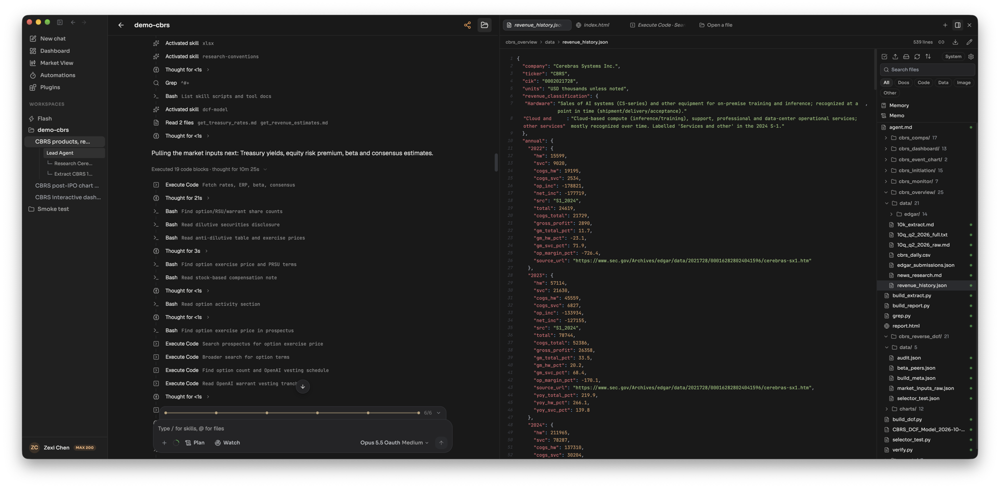<br /><sub><b>Çalışma Alanı Dosyaları</b>: yığın veriler ajanın bağlamına değil dosyalara yazılır. Fiyatlar, bildirimler ve model girdileri dosya ağacında her görevin <code>data/</code> klasörünü doldurur</sub></td>
    <td width="50%" align="center" valign="top">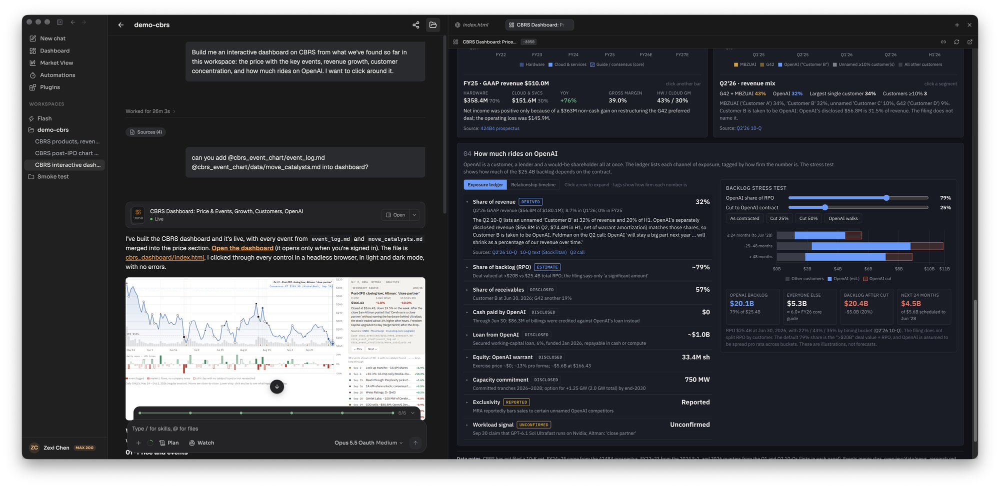<br /><sub><b>Çalışan uygulamalar</b>: ajan etkileşimli panolar oluşturur. Kaynağını görmek için bir çubuğa, işaretçiye veya satıra tıklayın; OpenAI sipariş stoku stres testini sürükleyin veya başka bir dizinin dosyalarını birleştirmek için <code>@</code> ile etiketleyin</sub></td>
  </tr>
</table>

### ⏰ Nöbet tutan ajanlar

Piyasa açılışından önce bir özet planlayın veya bir hisse belirli bir fiyatı geçtiğinde ya da gün içinde belirli bir yüzde hareket ettiğinde bir ajanı uyandırın. Sonuçlar tek bir akışta toplanır; bağlayıp teslimat kanalı olarak seçerseniz Slack, Discord, Telegram, Feishu veya iMessage'a da iletilir.

> *"CBRS'yi benim için takip et. Modelin varsayımlarını her pazartesi kontrol et, 3. çeyrek sonuçlarından sonra güncelle ve hisse boğa senaryosu değerimizin üzerine çıkarsa veya 95 doların altına düşerse bana haber ver."*

Ajan çalışma alanında dört otomasyon kurar: haftalık bir varsayım kontrolü, 3. çeyrek sonuçlarının ertesi sabahı çalışacak tek seferlik bir model güncellemesi ve iki fiyat tetikleyicisi — biri DCF modelindeki boğa senaryosu değerinde, diğeri ise tavsiyeyi değiştirecek 95 dolar seviyesinde. Her çalışma çalışma alanındaki model ve notlardan başlar ve Slack'e raporlar.

<table align="center">
  <tr>
    <td width="50%" align="center" valign="top">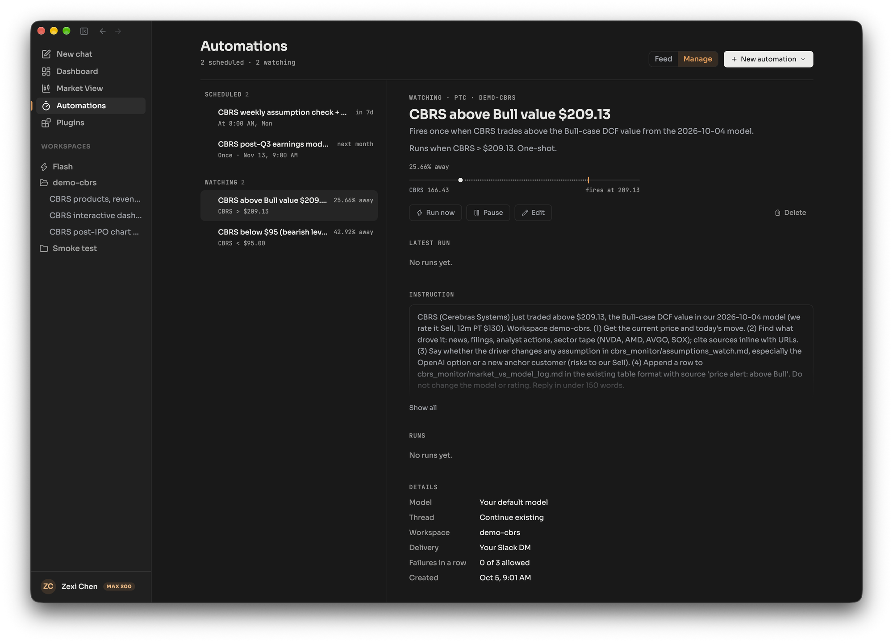<br /><sub><b>Otomasyonlar</b>: her zamanlama ve fiyat takibi tek sayfada; her birinin tetiklenmeye ne kadar yakın olduğu ve sonuçların nereye gideceğiyle birlikte</sub></td>
    <td width="50%" align="center" valign="top">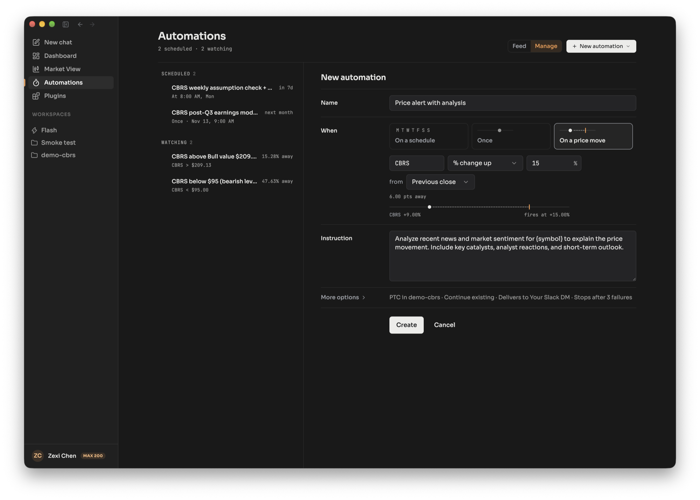<br /><sub><b>Fiyat hareketinde</b>: önceki kapanışa veya gün açılışına göre yüzdelik harekette ajanı uyandırın; bugünkü hareket eşiğinizin yanında gösterilir</sub></td>
  </tr>
</table>

### 📑 Sadece bir yanıt değil, doğrudan çıktıyı alın

Canlı formüllü Excel modelleri, PDF ve HTML raporları, sunumlar ve etkileşimli panolar. Yerleşik yetenekler DCF, emsal karşılaştırması (comps), bilanço ön izlemeleri, kapsama başlangıç raporları, sabah notları ve işlem önerilerini kapsar.

> *"Bunu CBRS üzerine bir satış tarafı (sell-side) başlangıç raporu gibi yaz: tavsiye, hedef fiyat, tez, piyasanın neyi fiyatladığı, senaryolar, emsaller, temel riskler ve grafikler. Halihazırda sahip olduğumuz araştırmayı ve modeli kullan."*

Başlangıç raporu yeteneği, dizinin başındaki araştırma ve ters DCF çalışma kitabının üzerine inşa edilir ve on sayfalık bir rapor yazar: 130 dolar hedef fiyatla Sat tavsiyesi, senaryolar, emsaller, riskler ve yedi grafik — PDF olarak ve [HTML sürümüyle](https://app.langalpha.ai/a/eedVW2kllALZ) birlikte. Hesap tablosu panelinde bir aralığı seçip soru sormak için doğrudan ajana geri gönderebilirsiniz. Slack bağlıysa her şeyi göndermesini isteyin; her dosya doğrudan açılmaya hazır şekilde DM kutunuza düşer.

<table align="center">
  <tr>
    <td width="50%" align="center" valign="top">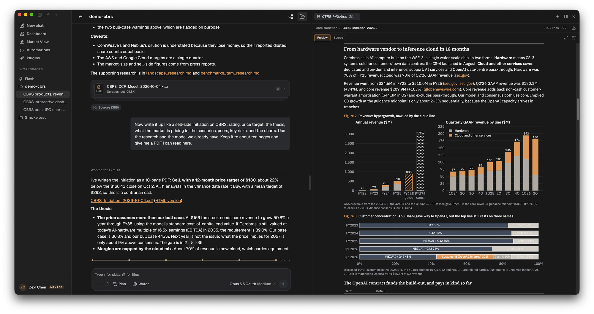<br /><sub><b>Dosya paneli</b>: HTML raporunu işlenmiş haliyle veya kaynak olarak okuyun; dayandığı resmi bildirimler ve basın bültenleri metin içi atıflarla yer alır</sub></td>
    <td width="50%" align="center" valign="top">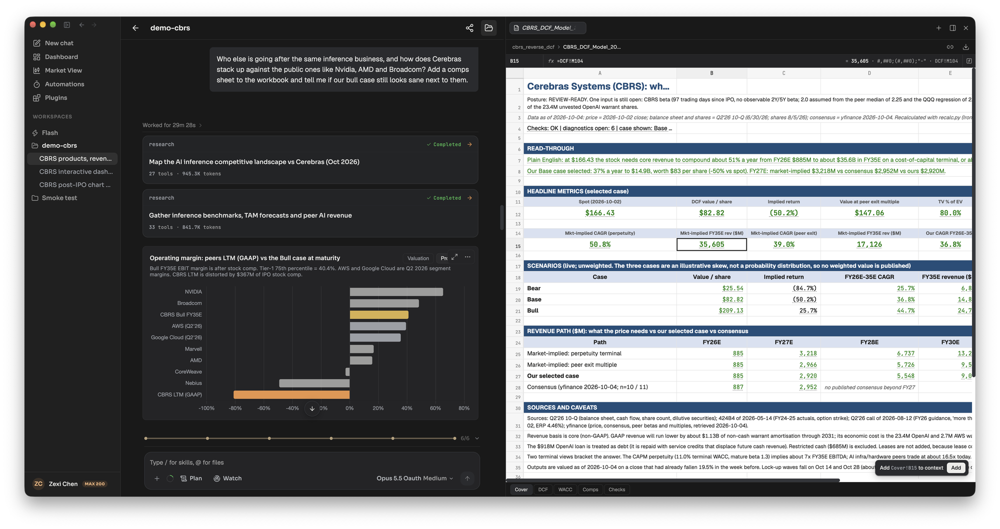<br /><sub><b>Hesap tablosu</b>: DCF, WACC, Emsaller ve Kontroller sekmelerinde canlı formüller içeren gerçek bir çalışma kitabı; yanında emsalleri besleyen araştırma koşumları</sub></td>
  </tr>
</table>

<table align="center">
  <tr>
    <td width="50%" align="center" valign="top">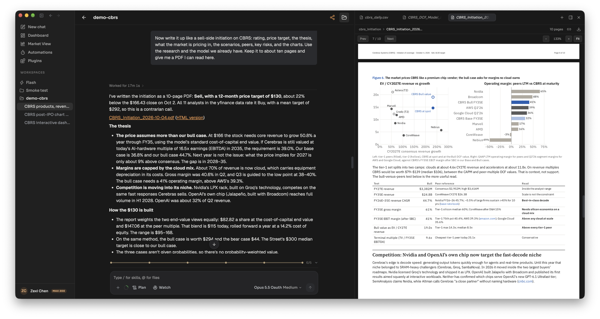<br /><sub><b>PDF görüntüleyici</b>: sohbetin yanında tamamlanmış PDF'te sayfaları çevirin ve yakınlaştırın; burada boğa senaryosunu emsal çarpanlar ve marjlarla test eden sayfa açık</sub></td>
    <td width="50%" align="center" valign="top">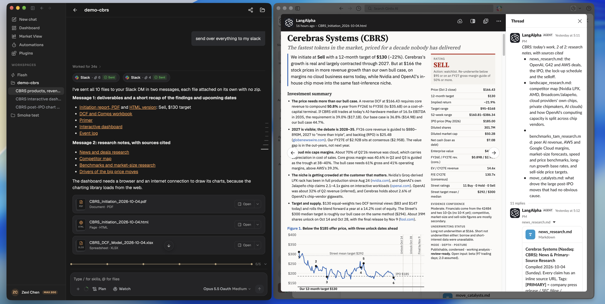<br /><sub><b>Slack</b>: tüm paket iki mesajda; önce çıktılar, ardından araştırma notları — her dosya kendi ileti dizisi yanıtında</sub></td>
  </tr>
</table>

### 📈 Ajanla birlikte grafik çizin

Ajanın herhangi bir sohbetten okuyup üzerine çizim yapabileceği canlı piyasa grafikleri: destek ve dirençler, trend çizgileri, Fibonacci seviyeleri ve olay işaretçileri, sembol ve zaman dilimi bazında kaydedilir. Piyasa Görünümü dışındayken çizim, sohbetin yanında aynı grafiği açan bir grafik kartı olarak gelir.

> *"CBRS'nin halka arzından bu yana grafiğini çiz ve onu hareket ettiren olayları işaretle: bilançolar, anlaşmalar, analist çağrıları ve kilit açılışları (lock-up)."*

Ajan her büyük günde hisseyi neyin hareket ettirdiğini çıkarır, ardından bunu canlı grafiğe çizer: 18 olay rozeti, 4 kilit açılışı işaretçisi ve 185 dolarlık halka arz fiyatı ile konsensüs hedef fiyatında referans çizgileri. Notunu okumak için bir rozetin üzerine gelin.

<p align="center">
  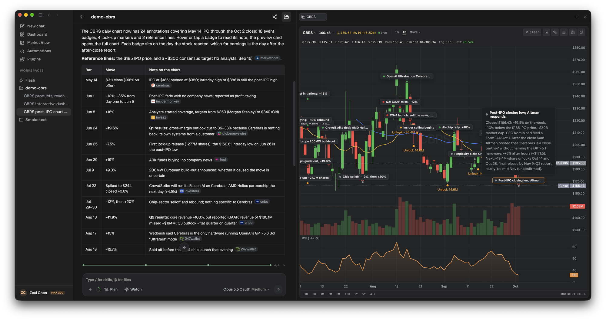
  <br />
  <sub><b>Canlı grafik</b>: her not hissenin tepki verdiği günün üzerinde yer alır ve sohbet her hareketi arkasındaki kaynakla birlikte bir tabloda listeler</sub>
</p>

### 🧾 Her yanıtın arkasındaki kanıtları görün

Kaynaklar (Sources) paneli, ajanın bir turda dokunduğu her resmi bildirimi, web sayfasını, veri çağrısını ve dosyayı — kendi Python ve Bash kodundan yaptığı veri çağrıları dahil — listeler; böylece güvenmek yerine çalışmayı doğrudan kontrol edebilirsiniz.

<p align="center">
  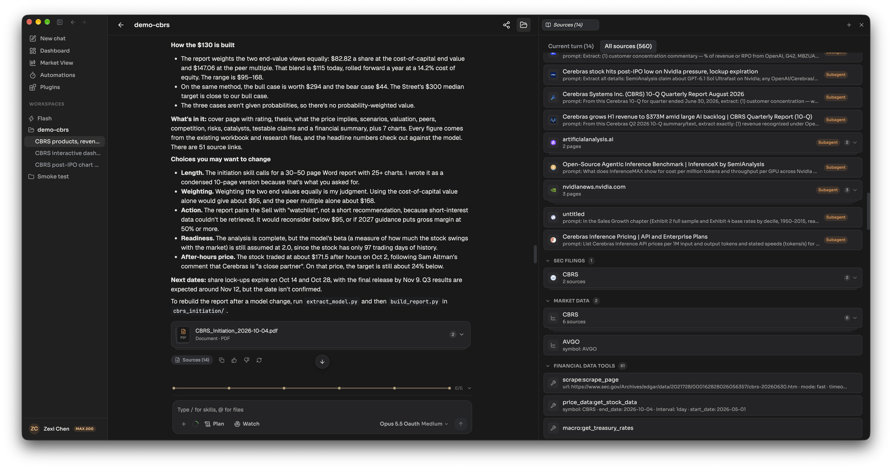
  <br />
  <sub><b>Kaynaklar</b>: bu turun 14 kaynağı ile dizinin 560 kaynağı arasında geçiş yapın; web arama ve tarama, SEC bildirimleri, piyasa verileri ve veri araçları olarak gruplanır, her biri çalıştığı istem veya argümanlarla görünür</sub>
</p>

## Ajan tabanlı işlem

LangAlpha'yı ajan tabanlı işlemler için en iyi çatı haline getirmeye kararlıyız. Aracı kurumlar artık yapay zekâ ajanlarının gerçek hesaplarda işlem yapmasına izin veriyor ve bağlanan ajanlar genel amaçlı olduğundan bir emir onlarca araç çağrısından biri haline geliyor. LangAlpha'da ise tüm çatının etrafında kurulduğu tek çağrı budur:

- **Model ne yaparsa yapsın geçerli kalan sınırlar.** Her bağlantının ne yapabileceği, hangi emirlerin onayınızı bekleyeceği ve onaylanan bir emrin tam olarak bir kez yürütüleceği kuralı sunucu tarafında, her emrin geçtiği tek [yönetilen yolda](#yönetilen-emirler) uygulanır. Hiçbir istem ve ajanın yazdığı hiçbir betik bu sınırları genişletemez; çalıştırdığınız her model için aynı kalırlar.
- **Okuyabileceğiniz bir emir yolu.** Bir emrin model çağrısından aracı kurumunuzun aldığı isteğe kadar geçtiği her kontrol bu depoda açık kod olarak yer alır. Para emanet etmeden önce okuyabilir ve aynı kontroller altında kendi makinenizde çalıştırabilirsiniz.

Bugün aynı kontroller altında dört aracı kurum bağlanabiliyor:

| | Robinhood | Interactive Brokers | moomoo | Webull |
| --- | :---: | :---: | :---: | :---: |
| Hesap, pozisyonlar, geçmiş | ✅ | ✅ | ✅ | ✅ |
| Piyasa verileri ve izleme listeleri | ✅ | ✅ | ✅ | ✅ |
| Emir ön izleme | ✅ | ✅ | | |
| Sanal işlem (paper trading) | | | ✅ | |
| Aracı kurum uygulamasında onaylanan bekletilmiş emirler | | ✅ | | ✅ |
| Canlı emirler | ✅ | ✅ | ✅ | |

Robinhood yalnızca yerel bir uygulamaya dönen oturum açmaları kabul ettiği için masaüstü uygulaması üzerinden bağlanır. moomoo ABD, Büyük Çin, Japonya ve Güneydoğu Asya piyasalarını kapsar.

Bir aracı kurum bağlarken salt okunurdan sanal işleme ve canlı emirlere kadar ne yapabileceğini siz seçersiniz.

<table align="center">
  <tr>
    <td width="50%" align="center" valign="top">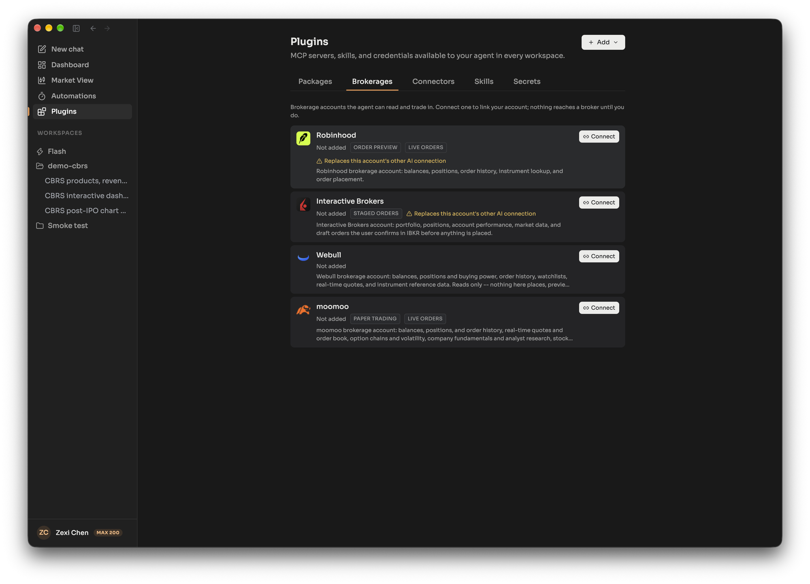<br /><sub><b>Aracı kurumlar</b>: aracı kurum hesabınızı bağlayın; her kart bağlamadan önce ajanın orada neler yapabileceğini listeler</sub></td>
    <td width="50%" align="center" valign="top">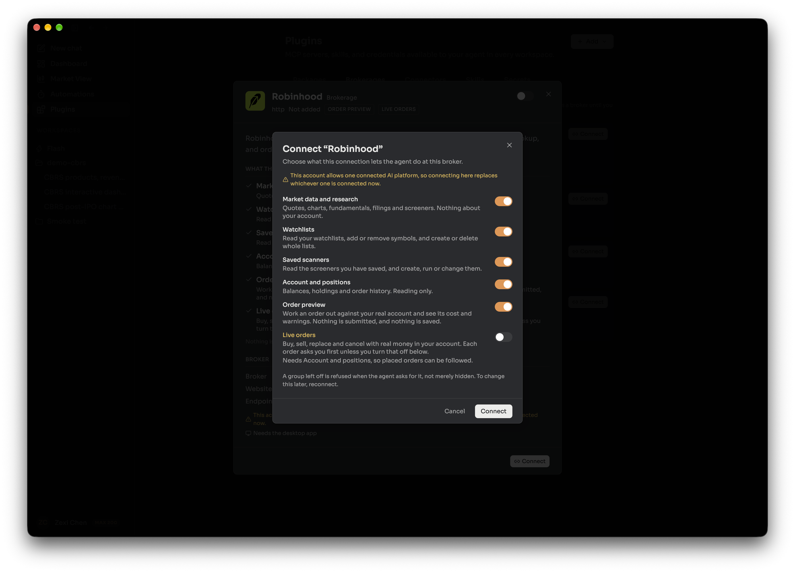<br /><sub><b>Yetkiler</b>: yalnızca güvendiklerinizi açın. Pozisyonlarınıza göre boyutlandırılan emirler bir onay kartında bekler ve siz evet demeden aracı kuruma hiçbir şey ulaşmaz</sub></td>
  </tr>
</table>

## Başlangıç

**Halihazırda ödediğiniz modeli kullanın.** Claude veya ChatGPT aboneliğinizle oturum açın; Kimi, GLM, MiniMax veya OpenCode Go kodlama planlarını kullanın; herhangi bir API anahtarı getirin ya da kendi sunucunuzda barındırırken yerel bir model çalıştırın.

**Olduğunuz yerden çalışın.** Tarayıcıyı, macOS, Windows ve Linux için [masaüstü uygulamasını](https://github.com/ginlix-ai/langalpha/releases) veya [LangAlpha.ai](https://langalpha.ai) üzerinden Slack, Discord, Telegram, Feishu ve iMessage'ı kullanın.

**Barındırılan sürüm (beta).** Ücretsiz başlamak veya planlarımızdan biriyle deneme başlatmak için [LangAlpha.ai](https://langalpha.ai) adresinden kaydolun. Piyasa verileri, bulut korumalı alanları (sandbox), aracı kurum bağlantıları ve kanallar sizin için hazır gelir. Beta süresince planlar ve özellikler değişebilir.

**Masaüstü uygulamasıyla kendi bilgisayarınızda barındırın.** macOS veya Linux için [açık kaynaklı masaüstü uygulamasını](https://github.com/ginlix-ai/langalpha/releases) kurun ve **Run on this computer** seçeneğini seçin. Kendi sunucusunu ve veritabanını içinde taşır, ayrıca başka bir şey çalıştırmanız gerekmez. Windows'ta uygulama, sizin çalıştırdığınız bir sunucuya bağlanır.

**Kaynak koddan kendi sunucunuzda barındırın.** Kodu değiştirmek veya bir sunucuda çalıştırmak için ihtiyacınız olan tek şey Docker'dır:

```bash
git clone https://github.com/ginlix-ai/langalpha.git && cd langalpha
make up       # Postgres, Redis, arka uç ve web uygulaması
```

[http://localhost:5173](http://localhost:5173) adresini açın. API 8000 portunu dinler ve `/docs` altında etkileşimli belgeler sunar. Adım adım kılavuz için [kendi sunucunda barındırma hızlı başlangıç rehberine](https://docs.langalpha.ai/get-started/self-hosting-quickstart/) bakın.

**Belgeleri okuyun.** [LangAlpha Nedir](https://docs.langalpha.ai/get-started/what-is-langalpha/) ürünü tanıtır; [CLI başvurusu](https://docs.langalpha.ai/cli/overview/) ise terminaller ve betikler için `langalpha` (kısaca `la`) komutunu kapsar.

Her iki yolda da ilk çalıştırmada ajanınızın nerede çalışacağı, nelerin kurulacağı ve hangi anahtarların ekleneceği sorulur: model sağlayıcınız ve isteğe bağlı olarak piyasa verileri ile web araması. Bunların hepsini daha sonra **Ayarlar** altından değiştirebilirsiniz. Terminalden yapılandırma için `make config` kullanılabilir.

**Kendi sunucunda barındırma farkları.** Ajanlar, çalışma alanları, otomasyonlar, yetenekler ve yönetilen emirler aynı şekilde çalışır. Geri kalanlar şu noktalarda ayrılır:

| | Barındırılan (Hosted) | Kendi sunucunuzda (Self-host) |
| --- | --- | --- |
| Piyasa verileri | ABD hisseleri ve opsiyonları için mesai dışı dahil canlı fiyatlar. Çin A-hisseleri yakında | Yahoo Finance veya FMP fiyatları, 60 saniyede bir yenilenir ve gecikmeli gösterilir |
| Opsiyonlar ve piyasa yapısı | Opsiyon zincirleri ve anlık görüntüler, açığa satış ilgisi, halka açıklık ve en çok hareket edenler | Kullanılamaz |
| Fiyat tetikleyicileri | Canlı fiyat tikleriyle tetiklenir | Gecikmeli fiyatlara karşı her 30 saniyede bir yoklar |
| Kanallar | Slack, Discord, Telegram, Feishu ve iMessage üzerinden sohbet edin ve otomasyon sonuçlarını alın | Web uygulaması ve masaüstü uygulaması. Otomasyon sonuçları sizin çalıştırdığınız bir webhook'a gider (`AUTOMATION_WEBHOOK_URL`) |
| Hesaplar | Kullanıcı başına ayrı verilerle oturum açma | Oturum açma gerektirmeyen tek yerel kullanıcı; erişebilen herkes bağlı aracı kurumlar dahil sizin adınıza işlem yapabilir. Kendi makinenizde veya özel ağda tutun |
| Modeller | Planınıza dahil modeller, kendi anahtarlarınız veya Claude ve ChatGPT oturumu | Kendi anahtarlarınız, kodlama planları, yerel modeller veya Claude ve ChatGPT oturumu |
| Erişilebilirlik | AWS US East üzerinde 7/24 çalışır; bilgisayarınız uykudayken bile otomasyonlar ve fiyat tetikleyicileri çalışır | Yalnızca makineniz ve Docker yığını açıkken çalışır |
| Uzaktan erişim | Her yerden tarayıcı, masaüstü uygulaması ve kanallar | Web uygulaması ve API tüm ağ arayüzlerini dinler, yani yerel ağınız erişebilir. Dışarıdan erişim için bir VPN veya kimlik doğrulamalı proxy arkasına kendiniz almalısınız |
| Operasyonlar | Yükseltmeler, geçişler, yedeklemeler ve sandbox kapasitesi sizin yerinize yönetilir | Yükseltmeleri, veritabanı geçişlerini ve yedeklemeleri siz yürütürsünüz. Docker sandbox'ları makinenizin CPU, bellek ve diskini paylaşır |

<details>
<summary><b>İsteğe bağlı anahtarlar ve açtıkları özellikler</b></summary>

| Anahtar | Açtığı özellik |
| --- | --- |
| `FMP_API_KEY` | Temel analiz, finansal tablolar, makro ve analist verileri ([ücretsiz katman](https://site.financialmodelingprep.com/)) |
| `DAYTONA_API_KEY` | [Daytona](https://www.daytona.io/) bulut korumalı alanları. Olmadan korumalı alanlar yerel Docker'da çalışır. Her kaynak katmanı ilk kullanımda kendi anlık görüntüsünü oluşturur veya önceden oluşturmak için `make daytona-snapshots` çalıştırın |
| `E2B_API_KEY` | Daytona anahtarı ayarlı değilken kullanılan [E2B](https://e2b.dev/) bulut korumalı alanları. Durdurma korumalı alanı duraklatır ve yaklaşık bir saniyede devam eder. Her kaynak katmanı ilk kullanımda kendi şablonunu oluşturur veya önceden oluşturmak için `make e2b-templates` çalıştırın. Kendi barındırdığınız E2B için `E2B_DOMAIN` (veya `E2B_API_URL` ve `E2B_SANDBOX_URL`) değerini ve `agent_config.yaml` içinde `sandbox.e2b.max_timeout` değerini planınızın en uzun süresine ayarlayın (Hobby varsayılan 3600 sn; Pro 86400 sn). Arşivleme yalnızca Daytona'dadır. Platform gizli anahtarları için `E2B_SECRET_NAMESPACE` ve her katalog girdisinde bir `header` gerekir |
| `agent_config.yaml` içinde `sandbox.offered_providers: ["ssh"]`, `BYOK_ENCRYPTION_KEY` ve `PREVIEW_PROXY_BASE_URL` ile birlikte | Kendi Linux makineleriniz ve Mac'lerinizdeki bilgisayarlar. Her kullanıcı bir VPS, bulut VM, sunucu veya (Uzaktan Giriş açık) Mac üzerinde bir istemci anahtarına yetki verir ve bunu adresle ya da orada çalıştırılan tek satırlık komutla ekler; ajan orada oturum açan kullanıcı olarak kendi klasöründe, ilk başlangıçta GitHub ve PyPI'dan indirip `~/.langalpha` altına kurduğu bir Python çalışma zamanıyla çalışır. Sunucu, `sandbox.ssh.allow_private_addresses` açık olmadığı sürece yalnızca genel adreslere bağlanır; kendi ağınızdaki veya LangAlpha'yı çalıştıran makine için bu ayar gerekir. Varsayılan olarak sunucunun tuttuğu hiçbir anahtar makineye gönderilmez; anahtar gerektiren yerleşik veri araçları (FMP) orada `client_unavailable` döner, anahtarsız olanlar (Yahoo Finance) her zamanki gibi çalışır. Yalnızca sizin kullandığınız bir dağıtımda `sandbox.ssh.trusted_host: true` ayarı makinelere diğer bilgisayarlarla aynı anahtarları gönderir |
| `BYOK_ENCRYPTION_KEY` ve `claude-code` eklentisi | Claude Code aracılığıyla kendi Claude planınız üzerinde Claude dizileri, varsayılan olarak açıktır (`config.yaml` içinde `features.claude_code_runtime.enabled: false` ile kapatılır). Arka uç `claude-code` eklentisine ihtiyaç duyar ve Docker imajları bunu varsayılan olarak dışarıda bırakır: sunucunuzda `uv sync --extra claude-code` çalıştırın veya imajları `INSTALL_CLAUDE_CODE=true` ile derleyin (`make up` için `.env` içine ekleyin; arka uç imajına yaklaşık 400 MB ekler). Arka ucu yeniden başlatın, ardından Settings → Model access → Connect a subscription → Claude Code yolunu izleyip bir kurulum belirteci ekleyin: oradan Claude ile oturum açın veya herhangi bir makinede `claude setup-token` ile oluşturduğunuz belirteci yapıştırın. Bu belirteç LangAlpha için üretilmiş ayrı bir kimlik bilgisidir ve hesabınız için şifreli saklanır: çalışma zamanı kendi Claude Code oturumunuzu asla okumaz, yenilemez veya yazmaz. Bir belirteç kaydedilene kadar Claude Code modelleri sizi Model access ekranına yönlendirir |
| `storage.provider` ile birlikte `R2_*`, `S3_*` veya `OSS_*` | Cloudflare R2, AWS S3, Alibaba OSS veya MinIO üzerinde nesne depolama. Çalışma alanı dosya anlık görüntülerini, notları, ekleri, yetenek arşivlerini, büyük dökümleri ve sohbet bileşeni verilerini tutar ve indirmeleri imzalı bağlantılarla sunar. Bir depolama alanı (bucket) olmadan bu veriler Postgres'te kalır ve grafik görseli yakalama kapalı olur |
| `TAVILY_API_KEY`, `SERPER_API_KEY`, `EXA_API_KEY`, `PARALLEL_API_KEY`, `BOCHA_API_KEY`, `DEEPSEEK_API_KEY` | Web araması. Motor `agent_config.yaml` içindeki `search_api` (varsayılan `tavily`) veya Ayarlar'dan kullanıcı bazında seçilir |
| `FIRECRAWL_API_KEY` | Gelişmiş web çekme ve site tarama. Yerleşik tarayıcı anahtar gerektirmez |
| `X_BEARER_TOKEN` | X gönderi araması ve dizi sorgulama. Eklentiler sayfasında kasa gizli anahtarı (vault secret) olarak ekleyin |
| `LANGSMITH_API_KEY`, `OTEL_EXPORTER_OTLP_ENDPOINT` | İzleme (tracing) ve metrikler |

Hiçbir veri anahtarı olmadan bile Yahoo Finance fiyatları, temel veriler, analist verileri ve tarama, SEC EDGAR bildirimleri ve yerel bir Docker korumalı alanı elde edersiniz. Tüm komutlar için `make help` çalıştırın veya arka ucu ve web uygulamasını doğrudan makinenizde çalıştırmak için [CONTRIBUTING.md](CONTRIBUTING.md#quick-start) dosyasına bakın.

</details>

## Harness tasarımı

**Modele hangi bağlamın, hangi biçimde ulaştığı ve ne üzerinde işlem yapabileceği harness'ı tanımlar.**

Yerleşik bir standart olduğunda LangAlpha, öncü laboratuvarların kendi ajanlarında sunduğu yaklaşımı izler: okuma, yazma, düzenleme ve arama yapan dosya araçları, bir Bash kabuğu, `SKILL.md` dosyaları olarak yetenekler ve `AGENTS.md` tarzında bir çalışma alanı `agent.md` dosyası. Bu biçimler büyük olasılıkla modelin eğitim verisinde yer aldığından model bunları nasıl kullanacağını bilerek gelir.

### Çalışma alanları ve bellek

Bir tez haftalarca, aylarca veya daha uzun süre — herhangi bir bağlam penceresinin çok ötesinde — takip edilir. Çalışma alanları ve bellek, bu süre boyunca ajanı aynı hedefte tutan yapıdır; bu yüzden ajan baştan itibaren tam bir çalışma alanına ve dosya sistemine kavuşur: geri kalan her şey bu temel üzerine kurulur.

Bir **bilgisayar** tek bir korumalı alana (sandbox) sahiptir. Her **çalışma alanı** bunun üzerinde kendi dizileri, dosyaları ve notlarıyla ayrı bir klasördür; böylece ikinci bir fikir yeni bir makine başlatmak yerine saniyeler içinde açılır. Tek bir bilgisayardaki çalışma alanları aynı işletim sistemi kullanıcısını paylaşır; yalıtım istediğinizde ayrı bilgisayarlar kullanın.

Her klasör ajanın güncel tuttuğu bir `agent.md` (hedefler, bulgular, dizi ve dosya dizini), ortak bir `data/` dizini ve her görev için bir klasör barındırır. Bellek, ayarlar ve geçmiş tek bir korumalı alanda değil sunucuda yaşar. Bir FUSE bağlaması bunları her bilgisayarda sıradan dosyalar olarak gösterir; böylece bilgisayarlar ve korumalı alan yeniden kurulumları boyunca taşınırlar ve Bash, kod ve dosya araçları hepsine aynı şekilde erişir:

| Depo | Ne tutar |
| --- | --- |
| Bellek (Memory) | Kullanıcı ve çalışma alanı bazında kalıcı tercihler ve bulgular. Ajan bunları proaktif yönetir: sizin ve çalışmanız hakkında öğrendiklerini kaydeder, güncelliğini yitiren kayıtları günceller veya siler |
| Profil (Profile) | Ajanın okuyup güncellediği JSON dosyaları olarak portföyünüz, izleme listeniz ve tercihleriniz |
| Otomasyonlar (Automations) | Her otomasyon için bir JSON dosyası. Ajan dosyasını yazarak otomasyon oluşturur, düzenler veya duraklatır; sunucu her kaydı yürürlüğe girmeden önce doğrular ve reddedilenleri araç sonucunda bildirir |
| İş akışları (Workflows) | Ajanın adıyla çalıştırabileceği, düzenleyebileceği veya yenisini ekleyebileceği kayıtlı iş akışı betikleri |
| Notlar (Memos) | Yüklediğiniz PDF'ler ve notlar; ajanın atıf yapabilmesi için ayıklanır ve dizinlenir. Ajan için salt okunurdur |
| Dökümler (Transcripts) | Geçmiş her sohbet dizisi aranabilir durumdadır; böylece ajan geçen hafta ne yaptığını kontrol edebilir. Salt okunurdur |

### Programatik araç çağırma

LangAlpha, Ocak 2026'daki ilk sürümünden bu yana programatik araç çağırma etrafında inşa edilmiştir. Ajan araçları her seferinde tek bir JSON çağrısıyla çağırmak yerine onları içe aktaran Python kodu yazar: LangAlpha herhangi bir [MCP](https://modelcontextprotocol.io) sunucusunu belgeleriyle birlikte bir Python modülüne dönüştürür ve kod korumalı alanda çalışır. Bunu iki neden yönlendirir:

- **Araçlar daha kullanılmadan bağlam tüketir.** JSON araçları olarak bağlandığında her sunucunun şeması, o turda gerekli olsun ya da olmasın her çağrıda taşınır. Burada istem her sunucu için tek bir satır taşır ve ajan bir sunucunun tam belgelerini ilk ihtiyaç duyduğunda bir dosyadan okur. Bu token tasarrufu sağlar, gürültüyü dışarıda tutar ve yeni bir sunucunun maliyeti yalnızca bir satırdır.
- **Finansal veriler düz metin değil tablodur.** Bir düzine hisse için on yıllık günlük veriler yaklaşık 30.000 satırdır. Bir model bununla metin olarak çalışamaz ve yapıştırmak pencereyi doldurur. Kod içinde ajan veriyi toplulaştırır, dönüştürür, grafiğe döker ve bir değerleme modeline ya da geriye dönük teste (backtest) besler; bağlama yalnızca sonuç döner.

<p align="center">
  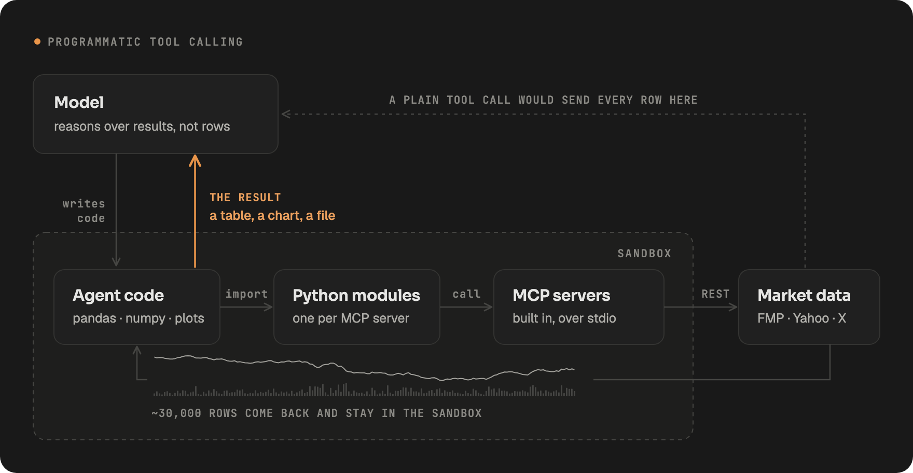
</p>

Kod varsayılan yoldur ama tek yol değildir. Herhangi bir MCP aracı, Eklentiler sayfasından araç bazında ayarlanarak düz bir JSON araç çağrısı olarak da çalıştırılabilir. Bu, her çağrının tek başına görünür olması gereken hesap işlemleri gibi hassas eylemler için uygundur ve bir emir aracı her zaman bu şekilde, [yönetilen yolda](#yönetilen-emirler) çalışır.

### Veri ve araçlar

Yığın veriler Python modülleri üzerinden kodla işlenir; hızlı sorgular ise **doğrudan** bağlıdır: bir fiyat, şirket özeti, resmi bildirim veya tarama tek bir JSON araç çağrısıdır ve sohbette bir kart olarak görünür. Her iki yoldan gelen ve bağlam için fazla büyük olan bir sonuç, yerine bir ön izleme bırakılarak dosyaya kaydedilir; ön izleme yeterli olmadığında ajan dosyayı kod içinde açar.

Kaynaklar üç veri türünü kapsar:

- **Piyasa verileri**: hisse senetleri, endeksler, kripto, döviz ve emtialar için anlık fiyatlar ve fiyat geçmişi, opsiyon zincirleri, tarayıcılar, piyasa ve sektör özetleri.
- **Temel ve makro veriler**: finansal tablolar ve oranlar, analist verileri, içeriden işlemler, bilanço ve ekonomi takvimleri, makro seriler ve getiri eğrisi.
- **Bildirimler ve metin**: SEC bildirimleri ve bilanço toplantı dökümleri, X gönderileri ve web sayfaları.

LangAlpha'nın kendi veri sunucuları kod tarafından işlenmek üzere tasarlanmıştır: her piyasa verisi aracı aynı zarfı (`symbol`, `currency`, `timezone`, `count`, `data`, `source`) döndürür, zaman serileri en eskiden yeniye sıralanır ve hatalar tipli hata kodları olarak gelir; böylece ajan kodu düz metin ayrıştırmak yerine sonucu doğrudan dizinler.

Sağlayıcılar piyasa bazında yedekli çalışır: ABD verileri için LangAlpha.ai üzerindeki gerçek zamanlı akış, temel ve makro veriler için FMP ve ücretsiz taban olarak Yahoo Finance. Web araması Tavily, Serper, Exa, Parallel, Bocha ve DeepSeek'i destekler; web çekme ise sağlayıcı bazlı devre kesicilerin arkasında isteğe bağlı Firecrawl veya DeepSeek yönlendirmesiyle yerleşik bir tarayıcı kullanır.

Veri dışında ajan şu araçlarla çalışır:

| Grup | Ajanın yapabilecekleri |
| --- | --- |
| Kod ve dosyalar | Python ve kabuk komutları çalıştırma, uzun işleri arka planda yürütme; dosya okuma, yazma, düzenleme ve arama; korumalı alandan sunduğu bir uygulama için ön izleme bağlantısı paylaşma |
| Web | Arama yapma, sayfa çekme ve Firecrawl ile tüm bir siteyi tarama veya haritalama |
| Çıktı | Sohbette etkileşimli bileşen (widget) oluşturma ve bir hissenin canlı grafiği üzerine açıklamalar çizme |
| Koordinasyon | [Alt ajanlar ve iş akışları](#alt-ajanlar-ve-ajan-ekipleri) dağıtma, size yapılandırılmış soru sorma ve açarsanız yapılacaklar listesi tutma |
| Bağlantılarınız | OAuth veya başlık (header) kimlik doğrulamasıyla aracı kurum ve uzak MCP sunucuları ile Ajan Eklentileri |
| Mesajlaşma | LangAlpha.ai üzerinde, dosya ekleriyle birlikte bağlı bir kanaldan size mesaj gönderme |

**Veri kökeni (data provenance)** katmanı, modelin bağlamı dışında ajanın dokunduğu her kaynağı kaydeder: modelin doğrudan çağırdığı ya da ajanın korumalı alandaki Python veya Bash kodundan yaptığı piyasa verisi ve MCP çağrıları, web aramaları ve çekilen sayfalar, SEC bildirimleri ile ajanın okuduğu dosyalar, notlar ve bellek. Her kayıt sağlayıcıyı, maskelenmiş argümanları, zaman damgasını ve sonucun parmak izini taşır; sonucun kendisini 64 KB'a kadar saklar ve çağrıyı yapan tura ve (ana veya alt) ajana bağlanır. Kaynaklar paneli bunları tur bazında listeler ve API aynı kayıtları döndürür; böylece her yanıt neye dayandığına göre kontrol edilebilir.

### Alt ajanlar ve ajan ekipleri

Ana ajan üç nedenle işi her biri kendi bağlam penceresine sahip **alt ajanlara** devreder:

- **Aynı anda daha fazla iş.** Alt ajanlar arka planda, birkaçı paralel olarak çalışırken ana ajan çalışmaya veya sizinle konuşmaya devam eder.
- **Daha geniş ve daha derin araştırma.** Bir soru şirket, segment veya kaynak başına bir alt ajan olacak şekilde yayılır; her biri kendi parçasının gerektirdiği kadar derine inebilir.
- **Büyük resmi koruyan bir ana ajan.** Bir alt ajan arkasındaki aramaları ve araç çağrılarını değil yalnızca bulgularını geri verir; böylece ana ajanın bağlamı tezi ve planı tutar ve rotada kalır.

Beş alt ajan yerleşik olarak gelir (`research`, `general-purpose`, `data-prep`, `equity-analyst`, `report-builder`) ve `agent_config.yaml` içinde daha fazlasını tanımlayabilirsiniz. Erişilebilir kalırlar: ana ajan çalışan bir alt ajana yeni talimatlar gönderebilir veya tamamlanmış birini tam geçmişiyle devam ettirebilir. Her birinin araç çağrıları ve çıktısı arayüze canlı akar ve doğrudan birine mesaj atabilirsiniz.

**İş akışları (Workflows)** ölçeği daha da ileri taşır. Büyük bir çalışma için ajan, sunucudaki yalıtılmış bir QuickJS çalışma zamanında `agent()`, `parallel()` ve `pipeline()` ile işi alt ajanlara dağıtan kısa bir JavaScript programı çalıştırır. Kayıtlı bir iş akışını adıyla çalıştırabilir veya anında yenisini yazabilir. Döngüyü sohbet değil program yürütür; bu nedenle yüz şirketlik bir tarama yüz sohbet turuna mal olmaz (yine de yüz alt ajanın token'larını harcar).

<p align="center">
  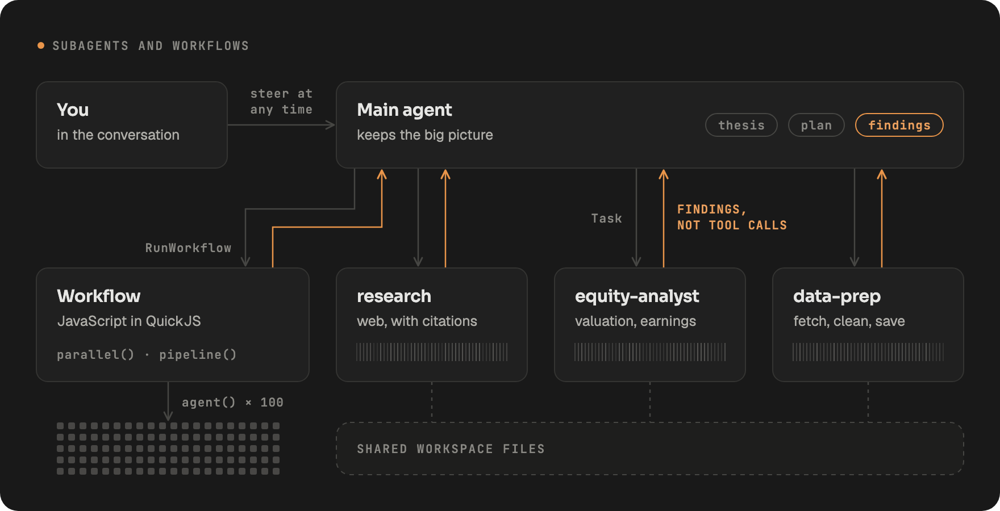
</p>

### Bağlam nasıl oluşturulur

Her model çağrısı en kararlıdan en değişkene doğru katmanlar halinde birleştirilir; böylece uzun bir oturum sağlayıcının istem önbelleğine (prompt cache) sürekli isabet eder.

<p align="center">
  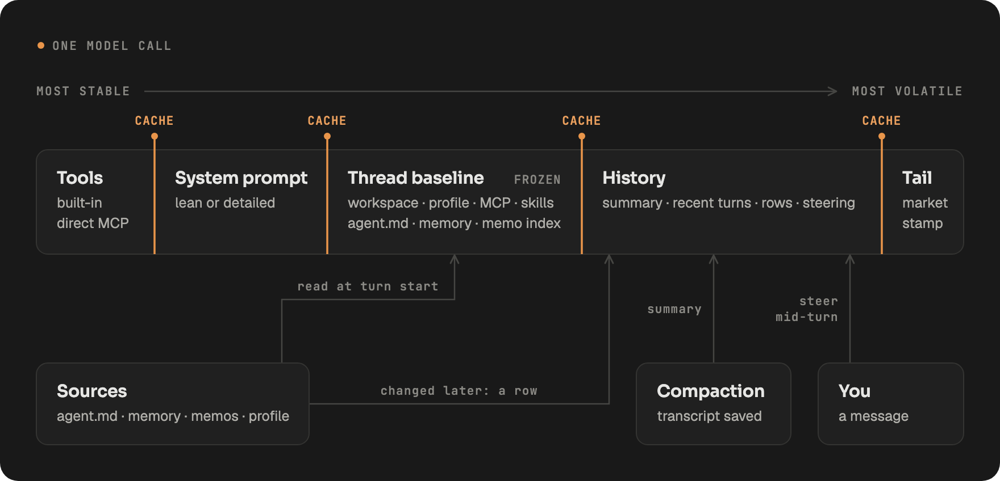
</p>

- **Sistem istemi.** Kullanılan modelin rehberlik düzeyine göre işlenen tek bir şablon.
- **Dizi temeli.** Bir tur başladığında bir kez okunur ve dondurulur: çalışma alanı, profiliniz, MCP sunucu listesi, yetenek manifestosu, `agent.md`, her iki bellek katmanı ve not dizini. Bunlardan biri daha sonra değiştiğinde ajan neyin değiştiğini bildiren kısa bir satır alır ve temel bayt düzeyinde aynı kalır. Sıkıştırma (compaction) sonrasında veya 20 satır biriktiğinde yeniden oluşturulur.
- **Çalışma zamanı satırları.** Her tur saati, değiştiğinde piyasa seansını ve son turdan bu yana geçen süreyi veren, her sağlayıcının beklediği biçimde gönderilen bir satırla açılır.
- **Yönlendirme (Steering).** Ana ajan veya alt ajan çalışırken gönderdiğiniz bir mesaj, bir sonraki model çağrısından önce araya girer.
- **Sıkıştırma (Compaction).** Önce eski araç argümanları kırpılır, özgün halleri dosya olarak saklanır. Modelin sınırına yaklaşıldığında eski turlar bir özete katlanır, tam döküm kaydedilir ve özet ajana bunu nereden okuyacağını söyler.

### Modeller

LangAlpha yalnızca öncü (frontier) modeller için ayarlanmamıştır. Aynı araçlar ve ara katman her modeli sürer; böylece açık ağırlıklı bir model maliyetin çok küçük bir kısmıyla karşılaştırılabilir sonuçlar verebilir. Dizi ortasında sağlayıcı değiştirin; başarısız bir çağrı yeniden denenir, ardından yapılandırdığınız yedek modele geçer.

Çoğu sağlayıcı Chat Completions biçimini kabul eder, ancak birçoğu için bu önemli özellikleri düşüren bir uyumluluk katmanıdır. LangAlpha her sağlayıcı için modellerine en iyi hizmet eden API biçimini seçer: OpenAI ve Codex için OpenAI [Responses API](https://platform.openai.com/docs/api-reference/responses); Claude, Kimi, MiniMax ve DeepSeek için Anthropic [Messages API](https://docs.anthropic.com/en/api/messages). Bu seçimi iki şey belirler:

- **Düşünme süreci korunur.** Akıl yürütme bir tur içinde ve turlar arasında sağlayıcısının kendi biçiminde modele geri döner: Anthropic'in imzalı düşünme blokları, OpenAI'ın şifreli akıl yürütme öğeleri, GLM'in akıl yürütme metni.
- **Çalışma zamanı bağlamı doğru kanaldan gider.** Çatı modele çok fazla çalışma zamanı bağlamı besler. OpenAI biçimli API'lerde `developer` mesajı, bunu destekleyen Anthropic ve GLM'de sohbet ortası `system` mesajı, diğerlerinde ise kullanıcı mesajı içinde gider.

Ayarlar'da hesap genelinde veya model bazında belirlenen üç ayar her modeli optimize eder:

- **İstem rehberliği.** Öncü modeller yalın bir istem alır; daha küçük modeller çözümlü örnekler ve adım adım prosedürler içeren ayrıntılı bir istem alır. İkisi de tek bir şablondan üretilir, bu yüzden asla birbirinden ayrışmazlar.
- **Akıl yürütme düzeyi.** `none` ile `max` arasında tek bir ölçek; her sağlayıcının kendi parametresine yazılır ve modelin sunduğu en yakın düzeye indirilir. Mesaj yazma alanından tek bir mesaj için geçersiz kılabilirsiniz.
- **Sıkıştırma profili.** 100K ile 750K token arasında sekiz ön ayar, uzun bir dizinin ne kadar erken sıkıştırılacağını belirler. Varsayılan olarak Claude ve GPT 500K'da, diğer modeller ise bağlam pencerelerinin elverdiği noktada sıkıştırılır.

| Bağlantı türü | Sağlayıcılar |
| --- | --- |
| Abonelik oturumu | Claude (Claude Code), ChatGPT (Codex) |
| Kodlama planları | Kimi, GLM, MiniMax, OpenCode Go |
| API anahtarı | OpenAI, Anthropic, Gemini, DeepSeek, Qwen (DashScope), Kimi (Moonshot), GLM (Zhipu), MiniMax, OpenRouter, Groq, Cerebras |
| Yerel | Ollama, LM Studio, vLLM |

Anahtarlar ve OAuth belirteçleri depolamada `pgcrypto` ile şifrelenir.

### Yetenekler ve eklentiler

Yetenekler [Agent Skills](https://agentskills.io/specification) belirtimini, eklentiler ise [Agent Plugins 1.0.0](https://agent-plugins.org) biçimini izler. Yerleşik MCP sunucuları ve yetenekler [`plugins/`](plugins/) içinde eklenti paketleri olarak sunulur — Eklentiler sayfasından yüklediğiniz veya bir git URL'sinden kurduğunuz biçimin aynısı. LangAlpha bu standartların üzerine şunları ekler:

- **Yetenekler talep üzerine yüklenir.** İstem yetenek başına bir manifesto satırı taşır; tam yetenek eğik çizgi komutuyla veya ajan `SKILL.md` dosyasını okuduğunda yüklenir. Bir yeteneğin getirdiği araçlar (otomasyon araçları gibi) yüklenene kadar gizli kalır.
- **Sizin yetenekleriniz, sizin komutlarınız.** Bir yeteneği zip olarak yükleyip seçtiğiniz bir eğik çizgi komutu verin veya ajanın GitHub'dan bir çalışma alanına kurmasını sağlayın.
- **Eklentiler için tek uzantı bloğu.** `mcp.json` biçimin kendi alanlarına kapalı kalır. LangAlpha'nın eklediği her şey `plugin.json` içinde biçimin tek uzantı noktası olan `extensions["ai.langalpha"]` altında yer alır: isteme ulaşan sunucu başına `description` ve `instruction`; ajanın her aracın ne kadarını baştan göreceğini belirleyen `summary` veya `detailed` değerli `tool_exposure_mode`; ve bir sunucunun ihtiyaç duyduğu her kimlik bilgisini ve nereye bağlanacağını adlandıran `secrets`. Bu bloğu kaldırsanız bile paket herhangi bir Agent Plugins ortamında kurulabilir. Ayrıntılar [`plugins/README.md`](plugins/README.md) içindedir.
- **Üçüncü taraf sunucular yalıtılmış çalışır.** Kodu LangAlpha'ya ait olmayan bir sunucu asla uygulamanın kendi ortamından değil sabitlenmiş `uvx` veya `npx` üzerinden başlatılır; böylece bir taraftaki SDK yükseltmesi diğer tarafı bozamaz.

<p align="center">
  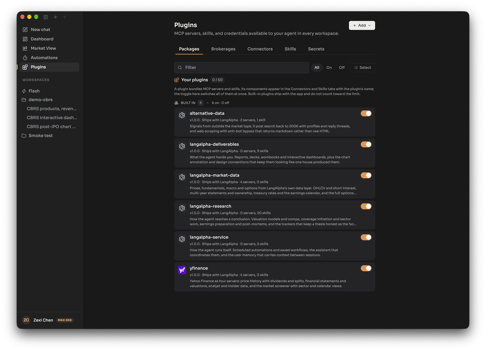
  <br />
  <sub><b>Paketler</b>: tek seferde açılıp kapatılabilen altı yerleşik MCP sunucusu ve yetenek paketi, ayrıca kendi paketleriniz için 50 adetlik alan</sub>
</p>

35 yetenek yerleşik olarak gelir:

| Paket | Yetenekler |
| --- | --- |
| Araştırma | DCF modeli, emsal analizi (comps), 3 tablolu model, model güncelleme ve kontrol, kapsama başlangıç raporu, bilanço ön izleme ve analizi, tez takibi, işlem önerisi, şirket profili, rekabet analizi, sektör özeti, etki analizi, katalizör takvimi, fikir üretimi, sabah notu, piyasa takibi, sunum kontrolü, portföy teşhisi, araştırma standartları |
| Çıktılar | Excel, Word, PowerPoint, PDF, HTML raporu, etkileşimli pano, satır içi bileşen, grafik açıklaması, arayüz tasarımı |
| Servis | İlk kurulum (onboarding), iş akışları, ürün yardımı |
| Alternatif veri | X araştırması, web kazıma (scraping) |

Teşekkür: Bazı araştırma yetenekleri [anthropics/financial-services-plugins](https://github.com/anthropics/financial-services-plugins) deposundan uyarlanmıştır.

## Tam yığın mimarisi

<p align="center">
  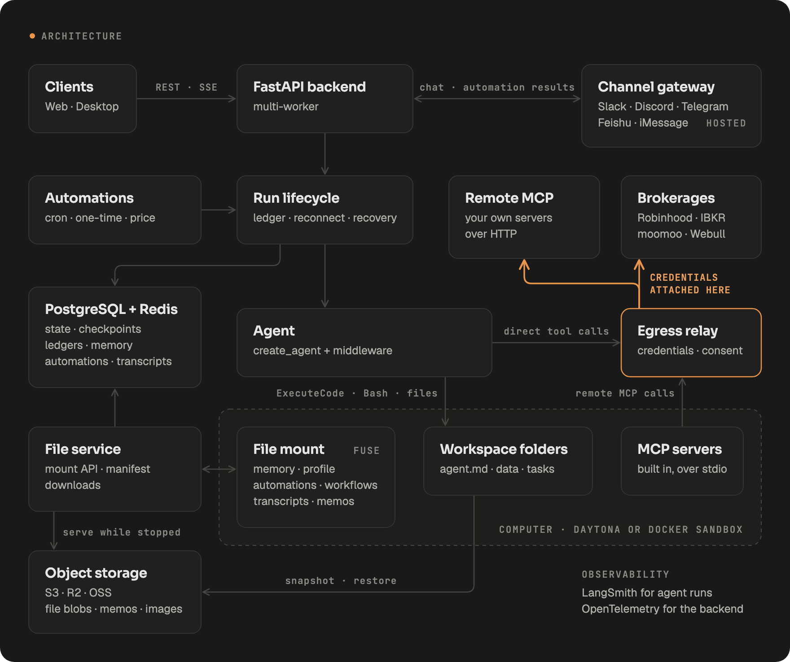
</p>

Bir tur, onu başlatan HTTP bağlantısından bağımsız bir arka plan koşumu olarak çalışır. Olaylar koşum başına bir Redis akışı üzerinden SSE ile iletilir; bu sayede kapanan bir sekme veya kopan bir ağ hiçbir şey kaybettirmez: istemci yeniden bağlanıp yetişir ve biten turlar LangGraph kontrol noktasından yeniden oynatılır. Tek gerçek kaynak Postgres, aktarım katmanı ise Redis'tir; bu nedenle arka uç birden fazla çalışanla (worker) koşar ve herhangi biri akışı sunabilir, kuyruğu boşaltabilir veya sahipsiz bir koşumu kurtarabilir. Yapılandırıldığında ajan koşumları LangSmith'e iz bırakır ve arka uç izleri ile metrikleri OpenTelemetry üzerinden dışa aktarır.

**Dosyalar korumalı alandan uzun yaşar.** Her turdan sonra ve bir bilgisayar durduğunda değişen her çalışma alanı klasörünün anlık görüntüsü alınır. Manifesto yol başına bir Postgres satırıdır. Baytlar korumalı alandan doğrudan S3 uyumlu nesne depolamaya gider veya nesne depolama olmadan çalıştırdığınızda Postgres'te kalır. Dosya tarayıcısı ve indirmeler bilgisayar kapalıyken de çalışmaya devam eder ve yeniden oluşturulan bir korumalı alan anlık görüntüden geri yüklenir. Bir hafta boyunca kapalı kalan bir Daytona bilgisayarı ayrıca tüm diskini soğuk depolamaya arşivler ve bir sonraki başlangıçta buradan devam eder.

**Kanal ağ geçidi (channel gateway)** LangAlpha.ai'ın bir parçasıdır. Slack, Discord, Telegram, Feishu ve iMessage sohbetlerini web uygulamasının kullandığı aynı sohbet API'sine taşır ve otomasyon sonuçlarını seçtiğiniz kanala gönderir.

### Yönetilen emirler

Bir emir gerçek para hareket ettirir, bu yüzden kendi yoluna sahiptir. Emir araçları doğrudan JSON çağrılarına sabitlenmiştir: tek bir çağrı, sistemin görebildiği, gösterebildiği ve durdurabildiği tek bir emirdir. Bir korumalı alan betiği tek bir yürütmede sınırsız sayıda emir verebileceğinden emir araçları orada asla erişime açılmaz.

<p align="center">
  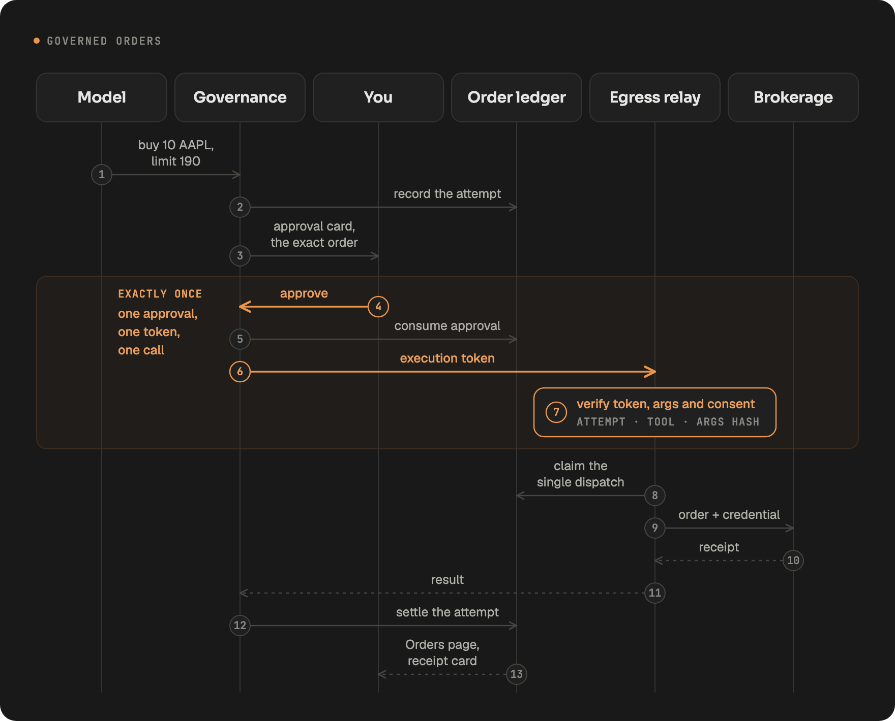
</p>

- **Bağlantı başına rıza.** Bir aracı kurum bağlarken hangi yetki gruplarını taşıyacağını seçersiniz. Aktarıcı, model ne isterse istesin bunların dışındaki her çağrıyı reddeder.
- **Emir başına onay.** Canlı ve bekletilmiş emirler varsayılan olarak onayınızı bekler, sanal emirler beklemez. Her mod sizin kontrol ettiğiniz bir anahtardır.
- **Tam olarak bir kez yürütme.** Bir onay, yalnızca o denemeye, o araca ve o argümanların özetine (hash) bağlı kısa ömürlü bir belirteç üretir. Değişen bir argüman, tekrar gönderim (replay) veya ikinci bir çağrı aktarıcıda reddedilir.
- **Aracı kurum kimlik bilgileri korumalı alanın dışında kalır.** Aracı kurum OAuth belirteçleri ve uzak MCP kimlik bilgileri sunucu tarafındaki aktarıcı tarafından eklenir; böylece ajanın yazdığı kod bunları asla görmez.
- **Okuyabileceğiniz bir kayıt defteri.** Her deneme, onay, ret ve gerçekleşme Emirler (Orders) sayfasına düşer ve bir mutabakat süreci emirleri aracı kurumun kendi kayıtlarıyla eşleştirir.

### Güvenlik

- **Kasa (Vault).** Bir API anahtarını bir kez saklayın ve herhangi bir çalışma alanındaki koddan `from vault import get` ile kullanın. Gizli anahtarlar depolamada şifrelenir ve bunları yalnızca sahibi görüntüleyebilir veya değiştirebilir.
- **Sızıntı maskeleme.** Her araç sonucu modele ulaşmadan önce bilinen gizli değerler açısından taranır ve eşleşmeler `[REDACTED:NAME]` ile değiştirilir. İndirmeler ve paylaşılan dosyalar da aynı işlemden geçer.
- **Yalıtılmış yürütme.** Ajan kodu bir Daytona, E2B veya Docker korumalı alanında ya da SSH ile eklediğiniz bir makinede oturum kullanıcısı olarak çalışır; korumalı yol kalkanları sistem dizinlerine erişen araç çağrılarını reddeder.

## Yol haritası

- [x] Araştırma çatısı: kod içinde veri, kalıcı çalışma alanları, ajan ekipleri
- [x] LangAlpha.ai ve masaüstü uygulaması
- [x] Yönetilen emirlerle aracı kurum bağlantıları
- [ ] Kripto ve tahmin piyasalarına göre uyarlanmış ajanlar
- [ ] Kendi yapay zekâ ajanınızın (ChatGPT, Claude) işlemleri LangAlpha'ya devretmesi

## Katkıda bulunma

Issue ve pull request'ler memnuniyetle karşılanır; [CONTRIBUTING.md](CONTRIBUTING.md) dosyasına bakın. Depo arka ucu ve ajan çekirdeğini ([`src/`](src/)), web uygulamasını ([`web/`](web/)), masaüstü kabuğunu ([`desktop/`](desktop/)) ve yerleşik eklentileri ([`plugins/`](plugins/)) içerir. İş birlikleri için [contact@ginlix.ai](mailto:contact@ginlix.ai) adresine e-posta gönderebilirsiniz.

<a href="https://star-history.com/#ginlix-ai/langalpha&Date">
  <picture>
    <source media="(prefers-color-scheme: dark)" srcset="https://api.star-history.com/svg?repos=ginlix-ai/langalpha&type=Date&theme=dark" />
    
  </picture>
</a>

## Sorumluluk reddi

LangAlpha bir yazılımdır, finansal danışman değildir. Ürettiği hiçbir içerik yatırım tavsiyesi veya herhangi bir menkul kıymeti alma ya da satma önerisi değildir. Ajanlar yalnızca verdiğiniz izinler dahilinde hareket eder ve hesaplarınızda verilen her emirden siz sorumlusunuz. Kendi durum tespitinizi yapın.

## Lisans

[Apache 2.0](LICENSE)
