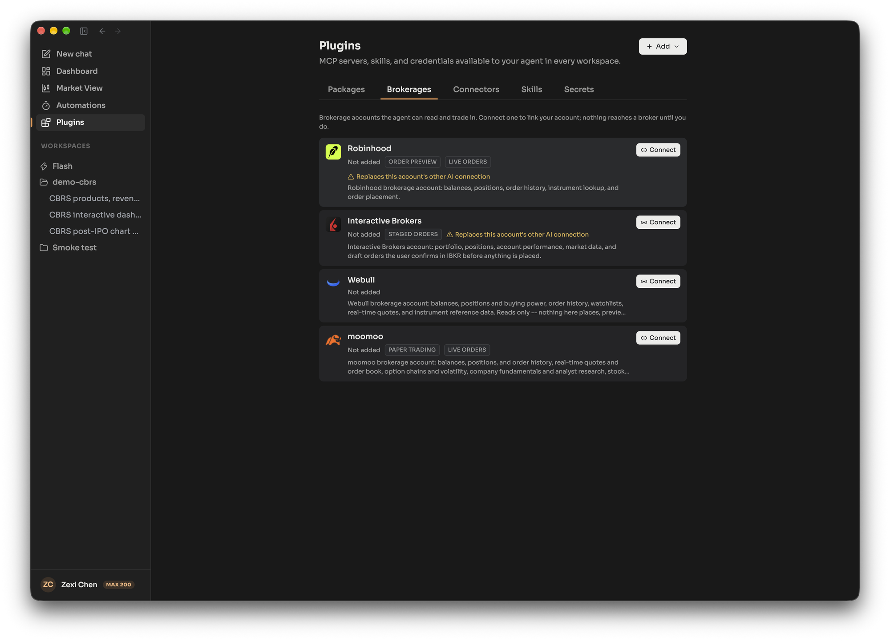
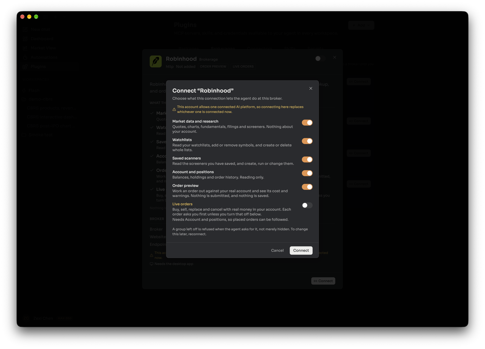
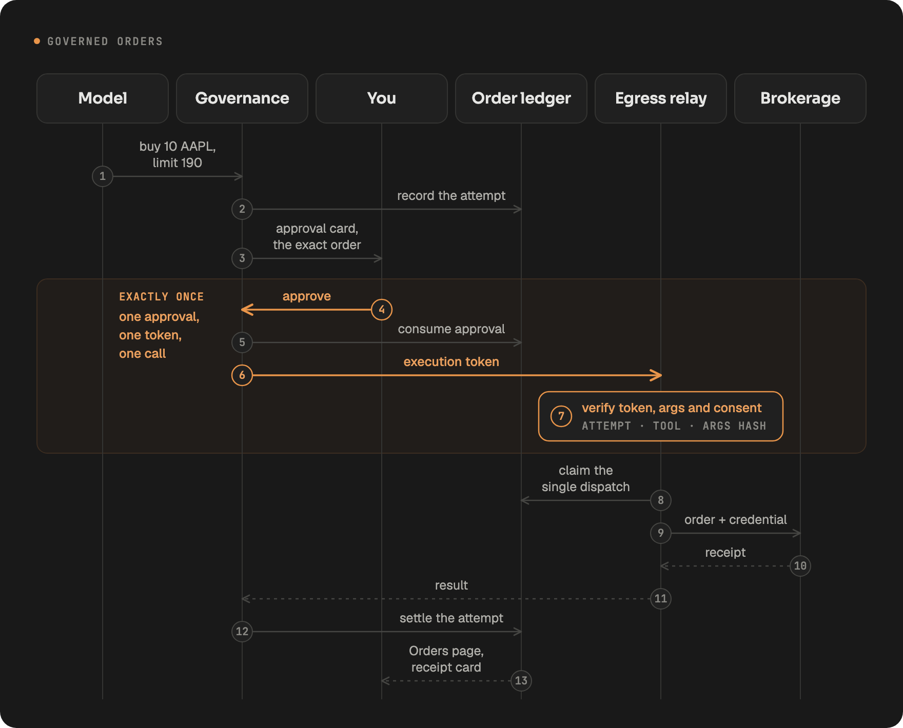

LangAlpha can connect to your brokerage account so the agent can read your positions and, if you allow it, place orders. Four brokerages are supported: Robinhood, Interactive Brokers, moomoo and Webull. You choose what each connection may do, a trading permission setting controls which orders wait for your approval, and every order the agent proposes is recorded, approved once and sent exactly once.

:::caution
LangAlpha is not financial advice. The agent can misread data, misunderstand an instruction or act on stale information. Orders are real and can lose money, and you are responsible for every order placed through your accounts, including any you did not see before they were sent.
:::

## What each brokerage supports

You connect brokerages on the **Brokerages** tab of the Plugins page. Each card lists what the agent can do there before you link it.

| | Robinhood | Interactive Brokers | moomoo | Webull |
|---|:---:|:---:|:---:|:---:|
| Account, positions, history | Yes | Yes | Yes | Yes |
| Market data and watchlists | Yes | Yes | Yes | Yes |
| Saved scanners and price alerts | Yes | Yes | No | No |
| Order preview | Yes | Yes | No | No |
| Paper trading | No | No | Yes | No |
| Staged orders, confirmed in the broker's app | No | Yes | No | Yes |
| Live orders | Yes | Yes | Yes | No |

Markets covered: moomoo covers US, Greater China, Japan and Southeast Asia. Webull covers stocks, options, futures, event contracts and crypto, and every Webull order is a draft that you confirm in the Webull app before anything trades. Interactive Brokers handles live stock and single-leg option orders as well as staged drafts you confirm in the IBKR app.

**Robinhood connects from the desktop app.** Robinhood only accepts sign-ins that return to an app on your own computer, so the connection cannot be finished in a browser. Connecting Robinhood or Interactive Brokers also ends any other AI-platform connection on the same brokerage account, because those brokers allow only one. The card warns you first.

## Capability groups

When you connect, you choose which groups of tools the connection carries. A group left off is refused when the agent asks for it, not just hidden. To change the choice later, reconnect.

| Group | What it allows |
|---|---|
| Market data and research | Quotes, charts, fundamentals, filings and screeners. Nothing about your account |
| Watchlists | Read your watchlists and change them |
| Saved scanners | Read, create, run or change your saved screeners |
| Price alerts | Read, create, change or delete price alerts |
| Saved charts | Read and change saved chart layouts and indicators |
| Account and positions | Balances, holdings and order history, read only |
| Paper trading | Trade the broker's simulated account, with no real money |
| Order preview | Price an order against your real account. Nothing is submitted or saved |
| Staged orders | Save a draft order into your account that you submit at the broker |
| Live orders | Buy, sell, replace and cancel with real money. Needs Account and positions switched on, so placed orders can be followed |

Not every group exists at every brokerage, as the table above shows. A few tools are held back deliberately and are refused whatever you grant.

## Trading permission

Trading permission is one setting per person, in Settings under Preferences, that applies across your brokerage connections. It decides whether live orders and staged drafts stop for your approval. Paper orders are not affected.

| Level | What it means | Needs an agreement |
|---|---|---|
| No trading | The agent does not start trades. If you ask for a specific order, it still waits for your approval | No |
| Approve each order (default) | Every live order and staged instruction waits for your approval before it is sent | No |
| Trade without approval, plan first | The agent agrees a plan with you, then can place orders inside it without waiting on each one. The plan step is guidance to the agent, and nothing enforces it | Yes |
| Full autonomy | The agent trades on its own judgment toward what you asked. It may place orders you are not aware of or have not approved | Yes |

Only you can raise the level. The two levels that skip approval require you to accept a written agreement, which says you are responsible for every order. The agent cannot change the setting, and nothing said in a conversation lifts the approval step. If the agreement is updated, you drop back to Approve each order until you agree again. Each connection also has its own approval switches, which can only add questions, never remove them while your level asks.

## How an order is governed

1. **Direct calls only.** Order tools always run as one visible tool call, never inside code the agent writes, so one call is one order that can be shown and stopped.
2. **Recorded first.** Every order call becomes a recorded attempt before anyone is asked. An attempt nobody answered is refused.
3. **Approved once.** When your level asks, the order appears as an approval card with its details. Your answer is written against that attempt.
4. **Executed exactly once.** An approval produces a short-lived token (valid for two minutes) tied to that attempt, that tool and the exact arguments. A changed argument, a replay or a second send is rejected before it reaches the broker.
5. **Credentials stay out of the sandbox.** Brokerage sign-in tokens are attached when the request leaves the server, so code the agent writes cannot see them.
6. **Followed to the end.** The **Orders page** lists every attempt across every conversation, with its time, mode, broker, instrument, side, size, price and status (for example awaiting your approval, open at the broker, filled, cancelled, rejected or failed). A background reconciliation job asks each broker what became of orders that are still open or were never confirmed. It only reads, and it never places, changes or cancels an order.

:::note[Hosted and self-hosted]
**Hosted:** Governed orders, capability groups and trading permission work as described, with sign-in separate for each user.

**Self-hosted:** The same order path and controls apply. A self-hosted install has no sign-in by default, so anyone who can reach the server acts as you, connected brokerages included: keep it on your machine or a private network. The reconciliation job can be configured in `config.yaml`.
:::

## Related

- [Plugins, MCP servers and programmatic tool calling](/concepts/plugins-mcp-ptc/)
- [Automations, wakeups and commands](/concepts/automations-wakeups-commands/)
- [Portfolio review](/explore/portfolio-review/)
- [Price-move automation](/explore/price-move-automation/)
