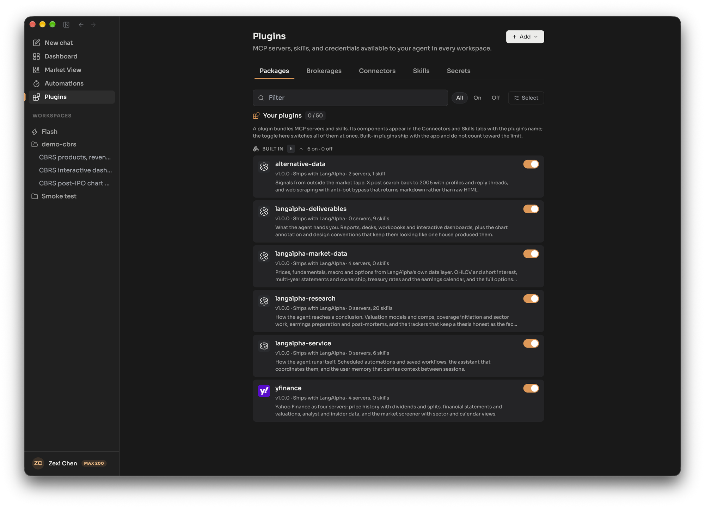
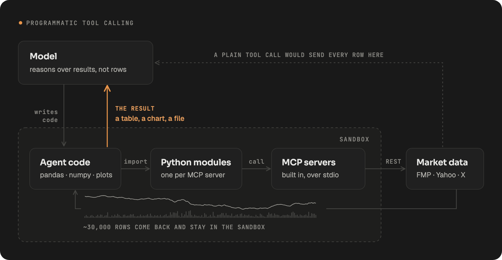

An **MCP server** gives the agent tools, such as market data, a web scraper or a broker connection. A **plugin** is a package that bundles MCP servers and skills so you install them together. **Programmatic tool calling** (PTC) is how the agent uses those tools by default: instead of calling each tool one at a time through the model, it writes Python code that imports the tools as modules and runs in the sandbox, so large data stays in the sandbox and only the result comes back to the model.

## Plugins

A plugin is a folder or archive in the open Agent Plugins 1.0.0 format: a `plugin.json` that names it, an optional `mcp.json` that lists its MCP servers, and an optional `skills/` folder with one directory per [skill](/concepts/skills/). Installing a plugin adds all of it to your account at once: its servers are switched on, its skills appear in every workspace, and you are asked for any secrets the plugin declares (you can skip that and fill them in later). Uninstalling removes its servers and skills, except any you customized, and keeps your secrets.

LangAlpha ships **six built-in plugins**: alternative-data, langalpha-deliverables, langalpha-market-data, langalpha-research, langalpha-service and yfinance. They carry the built-in market data servers and the built-in skills. They take none of your plugin slots, and there is nothing to uninstall, but you can switch each one off.

You manage everything on the **Plugins page**, whose tabs are Packages, Discover (when available), Brokerages, Connectors, Skills and Secrets.

### Installing a plugin

Choose Add, then **Install plugin**, and give it one of:

- a `.zip` or other archive you upload,
- a public `https` git URL on GitHub, GitLab, Codeberg or Bitbucket, or
- a direct `https` link to an archive.

When a repository holds several plugins you pick one. Claude, Codex and Cursor plugin repositories install as they are; their commands, agents and hooks are ignored. A repository with no `plugin.json` still installs if it contains `SKILL.md` folders: each becomes a skill of a plugin named after the repository. Limits: a package up to 64 MB, and up to 50 installed plugins per account.

The **Discover** tab lists a curated catalog of plugins you can install in one click. It only appears when an operator has configured a catalog.

## MCP servers

MCP (Model Context Protocol) is the standard way to give an AI agent tools. In LangAlpha an MCP server is installed on your account once and then **switched on per workspace**, so the same server has the same name and settings everywhere, and each workspace chooses whether it uses it. The built-in servers are on in every workspace by default.

Ways to add a server:

- **Form:** Add, then **Add MCP server**, and enter a URL, a command such as `npx -y <package>`, or pasted `{"mcpServers": {...}}` JSON. For a remote address the form can check it first, before saving, and show the tools it offers. A server added here is saved switched off for your account until you turn it on. A server added from a workspace's settings (MCP tab, Add server) is switched on in that workspace only.
- **Import:** **Import servers** takes a standard MCP configuration with several servers. Keys found in it are saved as secrets, and imported servers start switched off.
- **Plugin:** install a plugin that declares servers.

Rules for servers you add:

- A remote server must use a public `https` address. Local, private-network and `localhost` addresses are refused, and the address cannot contain credentials. Put a key in a header instead.
- A local server runs on your computer. Pin its version and run it isolated with `uvx` or `npx`; a bare `python` or `node` command is saved with a warning because it breaks when the shared environment changes.
- Names are a letter or underscore followed by letters, digits and underscores, up to 64 characters. The name becomes the module the agent imports.
- You can have up to 100 servers and 50 secrets.

### Secrets

Keys never go into a server's configuration as plain text. Save them on the Secrets tab, then reference them as `${vault:NAME}` in an environment variable, argument or header value (for example `Bearer ${vault:NAME}`). A plain `${NAME}` is rejected. The agent's code reads secrets through the vault and your keys are not pasted into chat. A secret belongs to your account, so every workspace and every server reads the same set.

### Sign-in (OAuth) connectors

A server that uses OAuth shows a Connect button on its row under Connectors. You sign in with the provider, and LangAlpha stores and refreshes the token for you. This works for a server added from a workspace too.

### When changes take effect

Changes apply without a restart. A running session picks up a new or changed server within about 30 seconds, and often sooner; the turn already in progress keeps the servers it started with. Each server's status in the workspace settings shows Connected, Pending, Error or Needs secret.

## Programmatic tool calling

With ordinary tool calling, each tool result flows through the model's context. Fetch five years of daily prices for 30 tickers and every row would have to pass through the model. With PTC, LangAlpha generates a Python module for each MCP server in the sandbox, and the agent writes a script that imports them, pulls the data, joins and charts it, and prints only a small result. The bulk rows stay in the sandbox files where later steps can reuse them, and the model's context stays small.

Each tool takes one of three paths:

| Path | What happens |
|---|---|
| Sandbox code (default) | The agent calls the tool from Python it runs in the sandbox |
| Direct | The model calls the tool as a single tool call, which you and the interface can see as one event |
| Both | The tool is available both ways |

You can set Direct or Both per tool for remote servers (a server that uses a header for sign-in needs a successful connection check first). Local servers and servers on the older SSE transport always run through sandbox code. **Order tools are always direct**: placing, changing or cancelling an order must be one visible event that can be approved, never a line inside a script, and nothing on a server's settings can change that. See [Brokerages and orders](/concepts/brokerages-and-orders/).

:::note[Hosted and self-hosted]
**Hosted:** Plugins, servers, secrets and the Discover tab (when a catalog is offered) are managed on the Plugins page of your account.

**Self-hosted:** The Discover tab appears only when `PLUGIN_MARKETPLACE_URL` is set in `.env` (a private catalog also needs `PLUGIN_MARKETPLACE_TOKEN`). Built-in servers that need a vendor key use the keys in your `.env`. You can add a bundle of your own as a folder under `plugins/` (restart to load it), or declare or override a single server under `mcp.servers` in `agent_config.yaml`.
:::

## Related

- [Skill, plugin or MCP server?](/compare/skill-plugin-or-mcp-server/)
- [Skills](/concepts/skills/)
- [Brokerages and orders](/concepts/brokerages-and-orders/)
- [Sandboxes and SSH](/concepts/sandboxes-and-ssh/)
