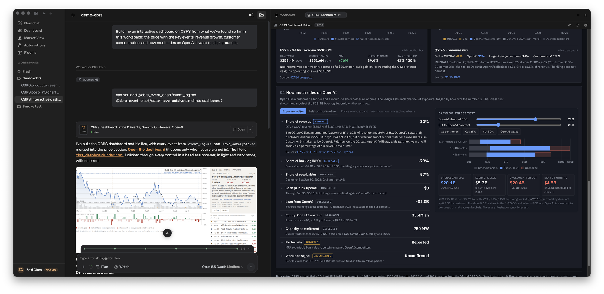
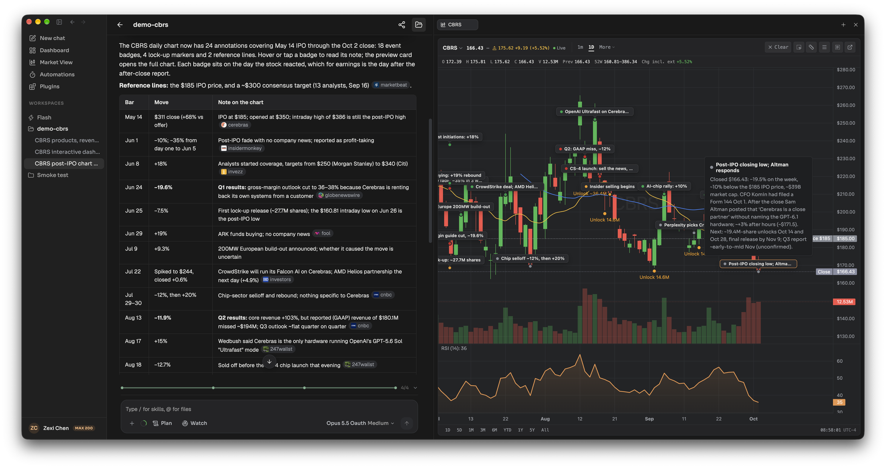
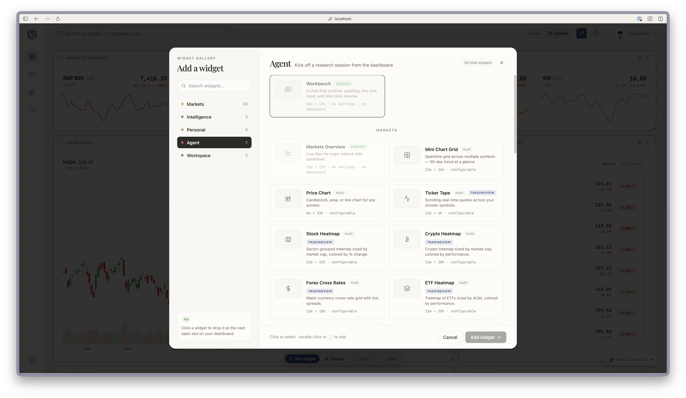

LangAlpha can show an answer as a picture in five ways, and the agent picks one from what you ask: a **widget** inside the chat, a **Python chart** saved as an image, an **HTML report** file you keep, a **live dashboard** served from your computer, or **annotations** drawn on a live price chart. This page says what each one is, how to ask for it and what you get, so you can name the one you want.

## Example request

> Build an interactive dashboard of how much of Cerebras's backlog rides on OpenAI, with the exposure ledger and a stress test, and merge in the event files from the other thread.

This is the dashboard request in the screenshot below. The agent builds the app in the workspace and opens it beside the chat.

## Which output to ask for

| You want | Ask for | What you get | Where it lives |
|---|---|---|---|
| One chart, a metric row or a small table inside the answer | A quick chart or table in the chat | An interactive widget between the text, with data embedded in it | In the thread only, no file |
| A figure for a document | A chart for the report | A static image the agent draws with code | A file in the workspace |
| A page you keep, print or send | An HTML report | One self-contained .html file | A file in the workspace, with a PDF export |
| Live data, server-side logic or a multi-page app | An interactive dashboard | A running web app opened in a side panel | A preview that works while the workspace runs |
| A level, a pattern or an event marked on a stock's price | Annotations on the chart | Drawings on a live chart | The chart, opened from a card in chat |

The skills behind these are `inline-widget`, `html-report`, `interactive-dashboard` and `chart-annotation`. The widget skill hands off to the dashboard skill when you need a multi-page app, live refresh or a server.

## What the agent does

**Widget.** It renders HTML or SVG straight into the chat, can pass it files from the workspace, and can make it interactive with sorting, toggles and hover. It can use common chart libraries from a CDN, and it cannot call other web addresses.

**HTML report.** It writes one styled file into the task folder. In the file panel it runs as a page, and you can view it fullscreen, open it in a new tab, download it, or save it as a PDF with a footer, page numbers and scale you set. Charts and tables are interactive, working over the data embedded in the file. See [Write an initiation report](/explore/initiation-report/) for one in use.

**Interactive dashboard.** It picks the simplest tier that works: a single HTML page, a FastAPI app with an HTML front end that polls for fresh data, or a FastAPI back end with a React front end for filtering and several pages. It then serves the app and opens it in a preview panel. The preview is live while the workspace runs, so for something you keep, ask for an HTML report.

**Chart annotation.** It calls a drawing tool with the ticker and timeframe, and the drawing lands on the live chart. Charts are identified by ticker and timeframe, so "NVDA, 1 day" and "NVDA, 1 hour" are separate charts, and several can be drawn in one turn. The types are price line, trendline, marker, vertical line, rectangle, text, event badge and Fibonacci retracement. You do not need to be on the chart page. Elsewhere in the app the drawing appears as a chart card in the chat, and clicking it opens the live chart beside the conversation. You can also select a region or a price level on the chart and send it to the agent, which then answers about that selection.

## Your own dashboard

Separate from what the agent builds, the Dashboard page is yours to arrange. Switch between Classic and Custom, add widgets from a gallery of 30 across Markets, Intelligence, Personal, Agent and Workspace, start from a preset, and rearrange them. A Watchlist widget switches between your watchlist and your holdings, and one button generates a personalized market brief from them.

## Tips

- **Name the output.** "A chart in the chat" and "a report I can send" get different files, while "a dashboard" gets a running app.
- **Ask for a Python chart when it belongs in a document.** The annotation tools are for looking, and the skill itself says to draw a Python chart when the output is a deliverable. You can ask for both.
- **Use the live chart for levels.** Ask "what are the key support and resistance levels for NVDA?" and the agent can mark them where you can pan and zoom.

:::note[Hosted and self-hosted]
**Hosted:** charts show live quotes for US equities, with extended hours.

**Self-hosted:** quotes come from Yahoo Finance or FMP, refreshed every 60 seconds and shown as delayed. Dashboards, reports, widgets and annotations work the same.
:::

## Related

- [Write an initiation report](/explore/initiation-report/)
- [Skills](/concepts/skills/)
- [Files](/concepts/files/)
- [Computers](/concepts/computers/)
