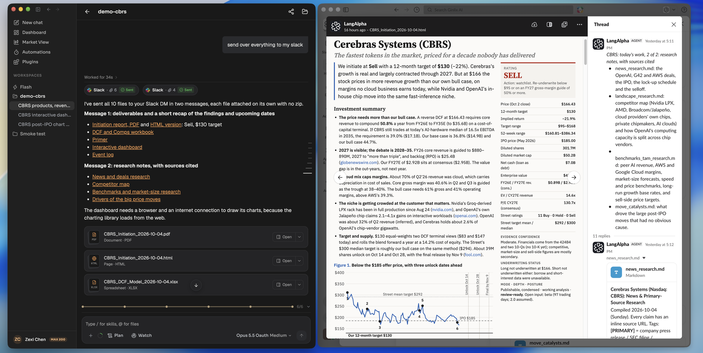

LangAlpha can send what it produces to a chat app. On the hosted platform you connect Slack, Discord, Telegram, Feishu or iMessage to your account, and then the agent can message you a result with files attached, and any automation can deliver its result to a chat when it finishes. A self-hosted install includes no chat apps. There, an automation run posts its start, completion and failure as JSON to a webhook address you set.

## Example request

> Send the initiation report, the workbook, the dashboard link and the research notes to my Slack DM.

This is the request in the screenshot below. The agent attached the files and the message arrived as a direct message, with the report open in Slack.

## Two ways to get results in a chat

**Ask the agent to send it.** In any thread, ask for something to be sent to you or to a chat. The agent sends text up to 20,000 characters and up to 10 files in one message. It can reach the conversation it is in, your direct messages, and the shared chats you allowed. The Chief of Staff can attach files from Home or from any workspace. In the web app each send shows as a delivery card with its status: sent, partly sent or failed.

**Deliver an automation.** On the Automations page, open More options on an automation and choose Delivery. You can pick an app, which lands in the workspace's default chat, then the app's preferred chat, then your direct messages, or name one chat. You can mark a chat as the workspace's default. With no app connected the picker says "No apps connected" and offers a link to connect one. You can also ask the agent to set delivery when it creates the automation, as in [Watch a stock and act on a price move](/explore/price-move-automation/).

## What the agent does with an automation delivery

1. Before the run starts, the messaging service resolves each delivery entry to one chat and holds the run.
2. The agent is told where to send and uses its send tool, so the result arrives as a message with its files.
3. When the run ends, a chat the agent did not reach gets the final answer. A failed or stopped run posts a short notice instead.
4. A reply in that chat thread continues the run's conversation.

If the messaging service cannot take a run, delivery falls back to the webhook, described below.

## Connect an app

:::note[Hosted and self-hosted]
**Hosted:** open Settings, then Integrations, then Chat apps. Each app shows Set up or Manage, which opens your account console where you connect it. Inside a chat, `/connect` also starts linking your account where the app supports it. iMessage appears in the list once it is linked.

**Self-hosted:** the Integrations section does not exist and no chat app is included. Set `AUTOMATION_WEBHOOK_URL` in `.env` and each automation run that chooses a delivery method POSTs JSON there for `automation.started`, `automation.completed` and `automation.failed`. Add `AUTOMATION_WEBHOOK_SECRET` and each request carries an `X-Webhook-Signature` header, `sha256=` followed by the HMAC-SHA256 of the request body. Without the URL, an automation can still save a delivery choice, but runs post only in the app. If you run your own channel gateway, set `CHANNEL_GATEWAY_URL` and the agent gets the messaging tools too. See [Chat apps](/concepts/chat-apps/#self-hosted-webhook-and-gateway).
:::

## What the agent can send, and where it works

Each chat conversation runs in All workspaces (the Chief of Staff) or in one workspace (that workspace's Analyst), which you choose with `/workspace`. A chat's conversation is an ordinary thread, so the reply is the same one you would get in the web app, and it shows there marked as coming from the app. For commands and routing rules per app, see [Chat apps](/concepts/chat-apps/).

## Tips

- **Ask for files by name.** "Send me the PDF and the workbook" attaches both. Up to 10 files go in one send.
- **Send results where you read them.** A daily briefing to a DM and a team report to a shared chat are separate automations.
- **Check the delivery card.** A partly sent or failed send names what did not go.
- **Expect a notice on failure.** A run that fails or is stopped posts a short notice to the chat instead of a result.

## Related

- [Chat apps](/concepts/chat-apps/)
- [Automations, wakeups and background commands](/concepts/automations-wakeups-commands/)
- [Watch a stock and act on a price move](/explore/price-move-automation/)
- [Hosted or self-hosted?](/get-started/hosted-or-self-hosted/)
