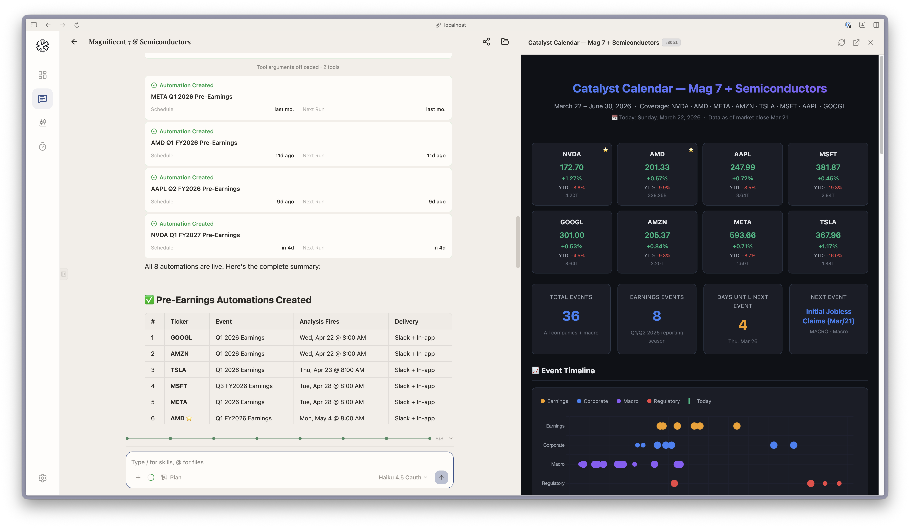
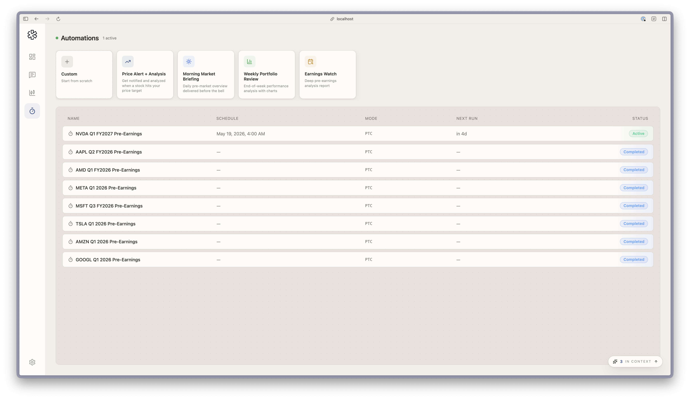

An earnings preview is a pre-report note on one company: where the market's expectation sits, what could clear or miss it, what to listen for on the call, and how the stock is likely to react. In LangAlpha you ask for it by name, or run the `/earnings-preview` command, and the Analyst builds it from your workspace's data tools. For several companies, you add a catalyst calendar and an automation that runs each preview on its own before the report. After the print, the `earnings-analysis` skill writes the update.

## Example request

> Build a catalyst calendar for NVDA, AMD, AAPL, MSFT, GOOGL, AMZN, META and TSLA through June. For each earnings date, set an automation that runs a pre-earnings analysis at 8:00 AM on the morning of the report and sends it to me in Slack.

This is the kind of request behind the screenshots on this page: one thread built a calendar for eight companies and created eight automations. For a single name, ask "Preview NVDA's next earnings" or type `/earnings-preview`.

## What the agent does

1. **Freezes the clock.** The preview records the as-of time and maps the reporting period, so every table and chart uses the same period labels.
2. **Builds the expectation bar.** The skill keeps five sources apart: the company's guide, published consensus, a whisper number when one is genuinely sourced, the agent's own base case, and last quarter's reported run-rate. It then states which one the stock is trading against.
3. **Checks earnings quality and picks the metrics.** It looks at what could flatter or hurt the reported EPS, bridges the guide to an implied bar, chooses the metrics that decide the quarter, and reads through from peers that already reported.
4. **Writes scenarios.** Bull, base and bear are set against the bar, not against last year, each with a driver, a management tell, a falsifier and a likely reaction. The reaction column is checked against how the stock moved after past reports.
5. **Writes the call questions.** Three or four ranked must-watch questions, each with why it matters, the answer that validates the view, the answer that breaks it, and phrases to listen for. Everything else goes into an overflow list.
6. **Lists what is missing.** The note closes with a missing-evidence block: each input it could not get, what would supply it, and which conclusion it blocks. A section without its input keeps its heading and shows a labelled gap instead of being shortened.

For a calendar across names, `catalyst-calendar` (also a command) ranks dated events by what they can change, such as earnings, regulatory decisions and macro releases, rather than by how soon they are.

## What you get back

- **Preview note.** A full note with the sections above, ending with a position action. Ask for a formatted document and it is built as a Word file. Ask for a shorter version and the skill rebuilds the note at that depth instead of cutting it.
- **Catalyst calendar.** An Excel workbook you can sort and filter by priority, class and date, plus a weekly preview note in Markdown. Ask about one date and you get a single-event brief. The skill keeps a version fit to leave your desk (dates, sources, confidence, public expectations) in a separate file from the one that carries your own positions and targets.
- **Automations.** Each one shows on the Automations page with its schedule, and finishes as Completed once it has run. Delivery can include a chat app, see [Get results in Slack and other chat apps](/explore/deliver-to-slack/).
- **Post-print update.** The `earnings-analysis` skill writes a Word update of eight to twelve pages by default, a one-pager on request, or only the call debate map when that is the whole ask. `/model-update` then refreshes your financial model for the new quarter and logs each change.

## Set it up as an automation

The Automations page has an **Earnings watch** template: a one-time run, in a workspace, with the instruction "Run a deep earnings analysis for {symbol}" that reviews statements, estimates, past surprises and options activity and writes a pre-earnings report. Pick the date and time, name the workspace, and set delivery under More options. You can also ask the agent in chat to create it, as in the example above.

:::note[Hosted and self-hosted]
**Hosted:** the preview can use options chains and snapshots for the implied move.

**Self-hosted:** options and market-structure data are not available, so the implied move is not one of the inputs you will get. Automations still run, and a self-hosted install posts each run's result to your webhook instead of a chat app.
:::

## Tips

- **Name the company and the quarter.** The skill maps the reporting period first, so naming it avoids a wrong guess.
- **Run it where your research lives.** In the workspace that already holds your model and notes, the agent can start from them.
- **Read the missing-evidence block first.** It tells you which conclusions to hold loosely.

## Related

- [Automations, wakeups and background commands](/concepts/automations-wakeups-commands/)
- [Skills](/concepts/skills/)
- [Build valuation models](/explore/valuation-models/)
- [Get results in Slack and other chat apps](/explore/deliver-to-slack/)
- [Chat apps](/concepts/chat-apps/)
