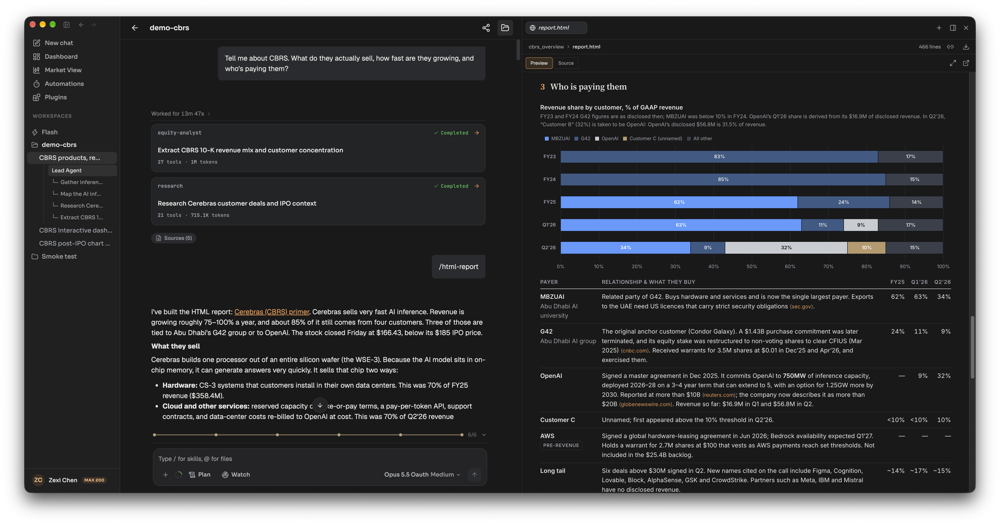
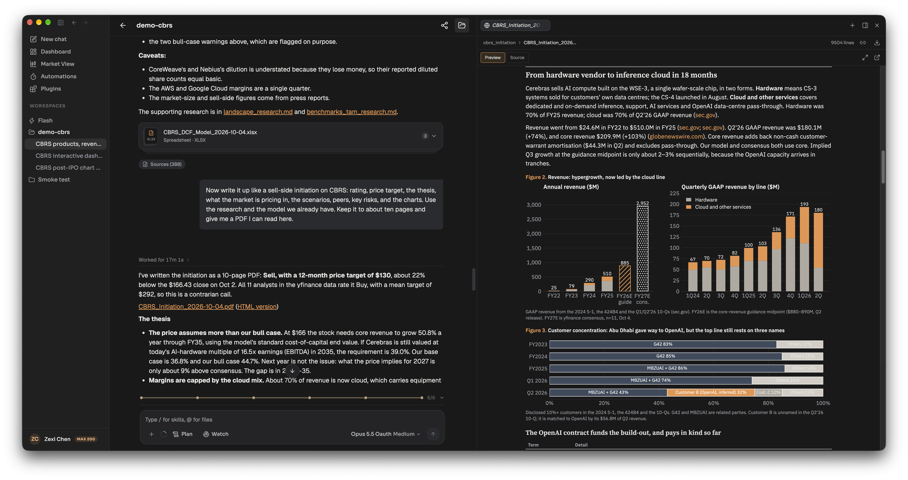
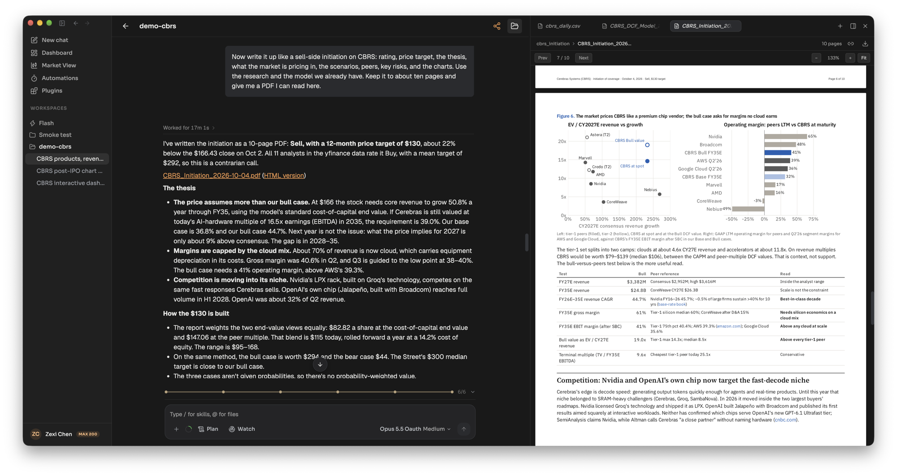

An initiation report is the first full write-up on a company: the business, a financial model, a valuation, a rating and the argument for or against owning the stock. In LangAlpha you ask the Analyst in a workspace for one, and it runs the `/initiating-coverage` skill. It researches the company, builds an Excel model with a valuation, draws the charts and assembles the report. By default the report is a 30 to 50 page Word document that comes with the Excel model. You can ask for something shorter, as a PDF or an HTML page, and read it in the file panel beside the chat.

## Example request

> Write it up like a sell-side initiation on CBRS: rating, price target, the thesis, what the market is pricing in, the scenarios, peers, key risks, and the charts. Use the research and the model we already have. Keep it to about ten pages and give me a PDF I can read here.

This is the request from the CBRS example run shown on this page. Replace CBRS with your ticker. If you start from nothing, ask for the whole run in one message, for example "Initiate coverage on [ticker] and run the whole initiation". A request that names no task and does not ask for the whole run, such as "write an initiation report for [ticker]", gets the list of five tasks back and a question about which to begin with.

*Research comes first: four subagents work the question under the lead agent, and /html-report turns their findings into a primer.*

## What the agent does

1. **Researches in parallel.** The Analyst hands questions to subagents. The research subagent searches the web, the equity-analyst runs code against financial data and builds models and charts, data-prep gathers bulk data, and report-builder writes documents. Their notes and data land as files in the workspace, so a later thread can build on them.
2. **Names the mode.** Before any task, the skill classifies the initiation into one of eight modes and writes down the mode and the reader it serves. The mode decides what content is required and what is cut.
3. **Runs five tasks, one per request by default.** Each task checks that its inputs exist, delivers its file and stops, so you can review before the next one. If you asked for the whole run, it continues and names each task as it finishes.
4. **Stops on a missing input.** Tasks 3, 4 and 5 depend on earlier ones. If an input is missing the agent names the task that supplies it instead of building a placeholder.
5. **Declines to invent a target.** If the valuation or the capital structure cannot be established, the report is labelled a preliminary or watchlist initiation, lists the evidence needed, and carries no price target.
6. **Puts the verdict on the cover.** The cover carries the rating (Buy, Hold or Sell) or posture, the price target or the preliminary label, evidence confidence, underwriting status and the initiation mode. Evidence confidence and underwriting status are separate fields on purpose.

| Task | File |
|---|---|
| 1. Company research | Markdown research document, 6,000 to 8,000 words |
| 2. Financial modelling | Excel model |
| 3. Valuation analysis | Markdown analysis, plus valuation sheets added to the same workbook |
| 4. Chart generation | Zip of 25 to 35 charts at 300 DPI |
| 5. Report assembly | Word report, 30 to 50 pages |

## What you get back

- **Word report (.docx)** at 30 to 50 pages, with the charts embedded and every source linked.
- **Excel model (.xlsx)** with live formulas, a Cover sheet first and a Checks sheet last. See [Build valuation models](/explore/valuation-models/).
- **Markdown notes** for the research and the valuation, and a **zip of PNG charts**.
- **A shorter PDF or HTML version** when you ask for one. In the CBRS run the agent wrote a ten-page PDF that rates the stock Sell with a $130 twelve-month target, plus an HTML version. It told the user that the skill's default is a 30 to 50 page Word report and that it wrote a condensed version because that was the request.

The file panel shows an HTML report rendered or as source, and offers a PDF export for it. A PDF opens in the PDF viewer, where you can flip pages and zoom.

## Tips

- **Do the research and the model first, in the same workspace.** The write-up above reused the research and the DCF workbook from earlier threads. Saying "use the research and the model we already have" points the agent at them.
- **Say the format and length you want.** Without it you get the skill's default: a 30 to 50 page Word report. "About ten pages, as a PDF" gets the condensed version. For a styled HTML page, use `/html-report`.
- **Open Sources under the answer** to see what the agent read: web pages, SEC filings, market data and subagent reads.
- **Expect a skeleton for thin coverage.** For a recent listing or a company with sparse disclosure, the skill delivers a research agenda and the model it would need, and says so on the first page, instead of filling gaps with plausible detail.
- **Your own files stay as they are.** When you give the agent a model or a draft, it makes a versioned copy and marks what changed.

## Related

- [Build valuation models](/explore/valuation-models/)
- [Skills](/concepts/skills/)
- [Chief of Staff and Analysts](/concepts/chief-of-staff-and-analysts/)
- [Research output best practices](/best-practices/research-output/)
