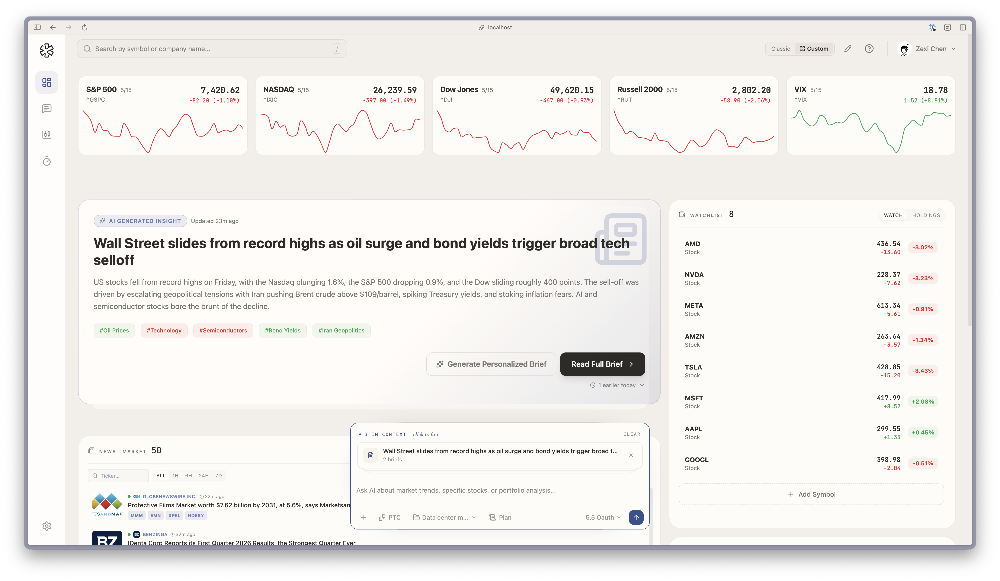

A portfolio review in LangAlpha is a health check of the holdings you have saved, measured against the investing profile you filled in: how concentrated you are, how your money splits by sector, region and asset class, how much is cash, and whether the volatility and drawdown fit your risk level. You start it by asking, "diagnose my portfolio", or by running `/portfolio-diagnosis`. It ends in a short note of findings and two or three follow-up tasks, never in trades.

## Example request

> Run a health check on my portfolio. Am I too concentrated, and does the risk fit what I said I wanted?

If you have not saved any holdings yet, the agent says the check needs them and asks for a few positions as ticker and quantity.

## Where your holdings come from

The agent reads the portfolio, the watchlists and the investing profile you saved. You can fill them in these ways:

- **First run.** After you save your profile, the onboarding skill imports holdings and watchlists from a brokerage you connected, without asking first, or reads screenshots of your positions you attached. A screenshot import is shown to you as a table to confirm before anything is saved. Cash balances are not saved, but the check uses them when it has them. It then proposes three first tasks, and the first is usually a health check on your holdings.
- **The dashboard.** Add a holding or a watchlist symbol from the dashboard's Portfolio and Watchlist widgets.
- **A connected brokerage.** When one is connected, the check takes positions and cash from it, and its quantities and values win over your saved file. If they differ, the agent says so in one line and offers to re-import. See [Brokerages and orders](/concepts/brokerages-and-orders/).

## What the agent does

1. **Pulls a year of prices** for every position, the benchmark for your main market (for example SPY for US holdings) and any currency pairs, and converts everything to your base currency.
2. **Measures concentration.** The largest position's weight, the top five combined, and an effective number of positions. A broad index ETF counts as diversified on its own.
3. **Measures exposure** by sector, region and asset class, and compares each with the markets, instruments and sectors you said you want.
4. **Measures risk** by replaying today's weights over the past year: annualized volatility, beta to the benchmark, and the one-year maximum drawdown. Holdings with under 60 days of history stay out of these figures.
5. **Judges the fit** against bands for your risk level, from conservative (volatility under 10%) to aggressive (over 22%). It flags, for example, a position over about 20%, one sector over about 40%, or cash over about 20%.
6. **Writes about 200 words.** A one-sentence headline with its number, three to five findings that each carry a number and what it is compared with, a data line naming what was left out and why, and two or three next tasks.

The skill saves its figures with the as-of date, so the next run can lead with what changed.

## Keep it going

| Task | How |
|---|---|
| Is a position's reasoning still intact? | `/thesis-tracker` keeps pillar status, an evidence ledger and monitoring triggers, and gives two separate verdicts: the company thesis and the security call. |
| What should I look at next? | `/idea-generation` screens a universe and returns a short ranked list, the rejected names, the method and a comparison table. When you supply holdings, it says which candidates add exposure and which duplicate it. |
| What happened overnight? | `/morning-note` writes a one-page briefing on overnight news, pre-market movers, earnings and macro events. |
| Check it every week | The **Weekly portfolio review** automation template runs Fridays at 22:00 US market time, in a workspace, and asks for returns against benchmarks, sector allocation, risk metrics and positions that need attention. |

Set the weekly review up on the Automations page, or ask the agent to create it. Delivery can go to a chat app, see [Get results in Slack and other chat apps](/explore/deliver-to-slack/).

## Tips

- **Fill in the profile.** With no risk level the check reports the risk numbers without saying whether they fit.
- **Run it in a workspace for your portfolio.** The saved figures live in that workspace, so later runs can compare.
- **Ask for the next task by name.** The agent offers tasks like a stress test of your largest position against a 40% drawdown. Pick one and it becomes a new request.

:::caution
LangAlpha is not financial advice. The review reports numbers and offers tasks. It does not tell you to buy or sell.
:::

## Related

- [Brokerages and orders](/concepts/brokerages-and-orders/)
- [Skills](/concepts/skills/)
- [Automations, wakeups and background commands](/concepts/automations-wakeups-commands/)
- [Watch a stock and act on a price move](/explore/price-move-automation/)
- [Build valuation models](/explore/valuation-models/)
