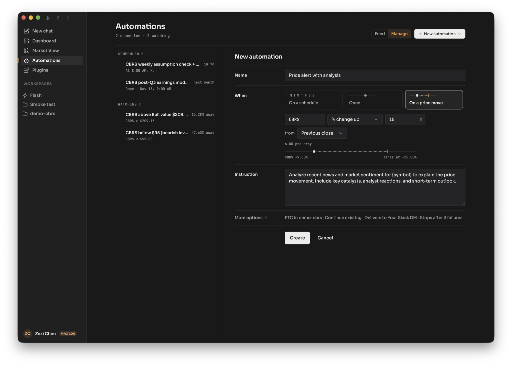
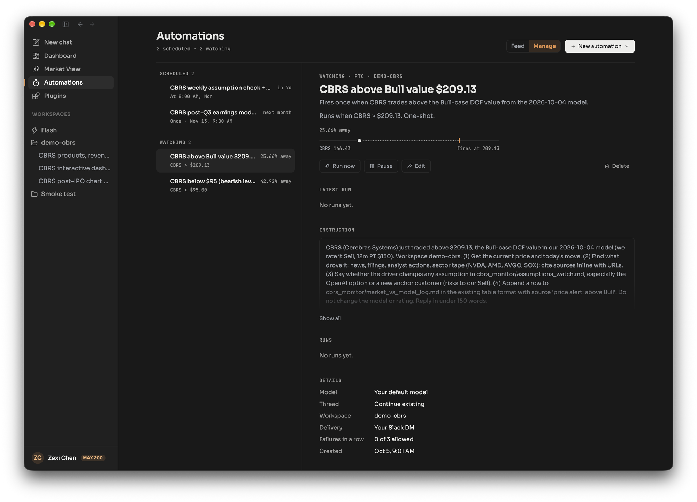

A price-move automation tells the agent to run an instruction when a stock or index crosses a level or moves by a set percentage, and the server watches the price for you, so nothing has to be open. You can set it on the Automations page, or ask the agent in chat. There are two other ways to follow a price: the market watch, which shows live prices to the agent while it works, and a price wakeup, which brings the agent back into the same thread when a level hits. This page shows which to use.

## Example request

> Wake the agent when CBRS rises 15% from the previous close, analyze what drove it, and send me the result in Slack.

This is the automation in the screenshot below. The agent summarizes the trigger and the instruction and asks for your yes before it creates the automation.

## Three ways to follow a price

| | Market watch | Price wakeup | Price automation |
|---|---|---|---|
| What it is | Live prices shown to the agent during a turn | A follow-up turn the agent sets in its own thread | A saved automation that starts a run |
| Who sets it | The agent, or you with the Watch control in the message box | The agent | You or the agent |
| Fires a run | No, it only shows prices while the agent works | Yes, in the same thread | Yes, in a new or an ongoing thread |
| Limits | Up to 10 symbols per thread, a stamp about every 25 seconds, expires after about 6 hours of inactivity | Up to 10 pending wakeups per thread, lasts through the next full market session | One US stock or index per automation |

For the full wakeup rules, see [Automations, wakeups and background commands](/concepts/automations-wakeups-commands/). For a decision guide, see [Automation or wakeup?](/compare/automation-or-wakeup/).

## What the agent does

1. **Watches the price on the server.** The monitor subscribes to the symbols in active price automations and checks them against your conditions. It does not need your browser or the agent to be running.
2. **Evaluates your conditions.** On the Automations page you choose a symbol, then a condition: price goes above, price drops below, % change up, or % change down. A percent condition measures from the previous close or from the day's open. If you add several conditions to one automation, all of them must hold.
3. **Starts a run.** The run uses your instruction, in the workspace you chose or in Home. The Price alert template's instruction asks the agent to analyze news and sentiment for the symbol and explain the move, with catalysts, analyst reactions and a short-term outlook.
4. **Re-arms or finishes.** A **one-shot** automation fires once and completes. A **recurring** one fires again after a cooldown of at least 240 minutes. Leave the cooldown empty and it fires at most once per trading day.
5. **Delivers the result.** The run is a thread you can open, and the result can go to a chat app. See [Get results in Slack and other chat apps](/explore/deliver-to-slack/).

The automation detail page shows how far the price is from its trigger, for example "25.66% away", with a bar from the current price to the level where it fires. It also has Run now, Pause, Edit and Delete.

## Limits

- **Symbols.** A price automation watches a US stock or an index. Crypto, currency and futures symbols are refused.
- **Failures.** After a set number of failed runs in a row (3 by default) the automation switches itself off. Resume it from the Automations page.
- **Market hours.** Prices only move while a market is trading. Outside the session there is nothing to cross.

:::note[Hosted and self-hosted]
**Hosted:** price triggers fire on live ticks.

**Self-hosted:** price triggers poll every 30 seconds against delayed quotes (Yahoo Finance or FMP, refreshed every 60 seconds), so a trigger can fire a minute or more after the move. Your install must be running for it to fire. Options and market-structure data are not available.
:::

## Tips

- **Write the instruction as a task.** The run starts cold, with only your instruction and the workspace's files. Say what to look for, where to save it and how long the answer should be.
- **Pick a level from your own work.** A level taken from a valuation model, such as a bull-case value, gives the alert a reason.
- **Use a wakeup when you are already in a thread.** Ask "tell me if it drops 3% today" and the agent sets one, no automation needed.

## Related

- [Automations, wakeups and background commands](/concepts/automations-wakeups-commands/)
- [Automation or wakeup?](/compare/automation-or-wakeup/)
- [Get results in Slack and other chat apps](/explore/deliver-to-slack/)
- [Hosted or self-hosted?](/get-started/hosted-or-self-hosted/)
