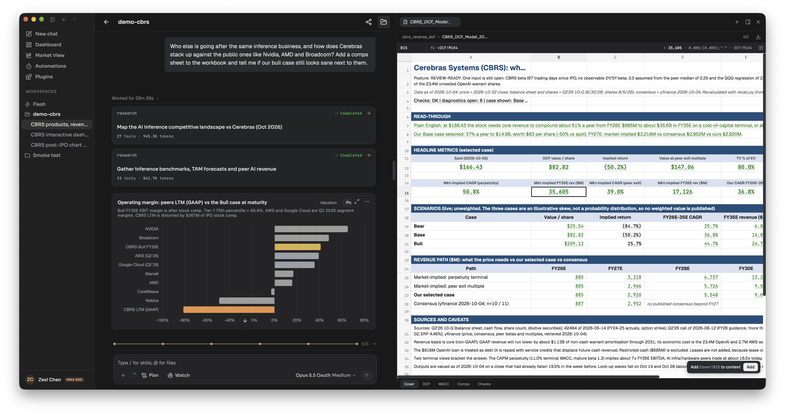
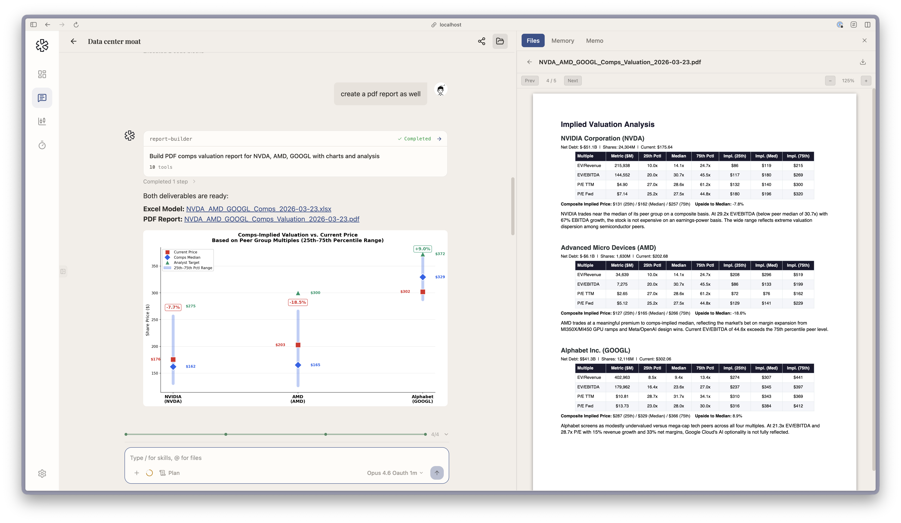

A valuation model in LangAlpha is an Excel workbook the Analyst builds in your workspace from a saved script, with live formulas rather than pasted values, a Cover sheet first and a Checks sheet last. Four skills cover the common jobs: `dcf-model` for a discounted cash flow, `comps-analysis` for trading comparables, `3-statements` for an integrated income statement, balance sheet and cash flow, and `check-model` to audit a workbook someone already built. The first, second and fourth are also slash commands: `/dcf-model`, `/comps-analysis` and `/check-model`.

## Example request

> Who else is going after the same inference business, and how does Cerebras stack up against the public ones like Nvidia, AMD and Broadcom? Add a comps sheet to the workbook and tell me if our bull case still looks sane next to them.

This is the request from the CBRS example run in the screenshot below. The workbook already held a reverse DCF, and the agent added a comps sheet and answered the question.

## What the agent does

**DCF.** It retrieves and validates the data, reads three to five years of history, builds revenue and operating-expense projections, computes free cash flow, sets a cost of capital, applies terminal value, and bridges enterprise value to equity value. The workbook carries three scenarios and three sensitivity grids. Each grid has a highlighted centre cell that must equal the model's headline output, and the build fails if it does not. A reverse DCF can solve for the growth or margin the current price implies. The skill needs the current price and net debt with their dates, and if one cannot be sourced it writes the input as required and absent, with a comment on what was searched, instead of defaulting it.

**Comps.** It frames the table, builds a peer set with a role for each name, fixes one basis for periods, currency and scale, pulls data with an as-of date on every row, and builds the enterprise value bridge. Headline statistics come from the closest peers (tier 1) only, and the names it excluded are listed in the deliverable. With fewer than three close peers the output is labelled screen-grade and falls back to a named single analogue.

**Three-statement model.** It keeps reported history on its own sheet, marks the boundary between history and forecast, puts every scenario switch on one control sheet, and holds only formulas on the calculation sheets. A balance check runs for every period.

**Model audit.** `check-model` reads your .xlsx or .xlsm, recalculates it, and reports without editing it: structure and formulas, integrity checks, a source tie-out ledger and reasonableness checks. The report opens with a readiness posture and ends with an issue log routed to whoever should fix each item.

All four build or read the workbook from a script, run a recalculation, and audit it before delivery. Every input in a model the skills build carries a comment naming its source.

## What you get back

- **An .xlsx workbook.** DCF and comps workbooks open on a Cover sheet with headline tiles that link to the model, and end on a Checks sheet with a roll-up that must read OK before delivery. Open it in the file panel's spreadsheet viewer, where you can select a cell and add it to the chat.
- **A written read of the result.** The DCF skill asks for a valuation range with the drivers that move you across it, not a single point.
- **A PDF or other report on request.** In the NVDA, AMD and GOOGL run below, the agent delivered the Excel model, then built a PDF report with a report-builder subagent when asked.
- **A versioned copy of your model.** `/model-update` and the editing rules in the skills copy your file and mark what changed instead of overwriting it.

## Tips

- **Give the model a workspace to live in.** Later requests such as "add a comps sheet" or "update for the new quarter" work on the same file.
- **Say what you want asked of the model.** "What does the price imply" gets the reverse DCF. "What should it trade at" gets comps.
- **Bring your own model for an audit.** Attach the workbook and ask the agent to check it. It reports and leaves your file alone.
- **Expect labelled gaps.** Where an input is missing or stale, the skills mark it rather than fill it in.

## Related

- [Write an initiation report](/explore/initiation-report/)
- [Prepare for earnings](/explore/earnings-preview/)
- [Skills](/concepts/skills/)
- [Files](/concepts/files/)
