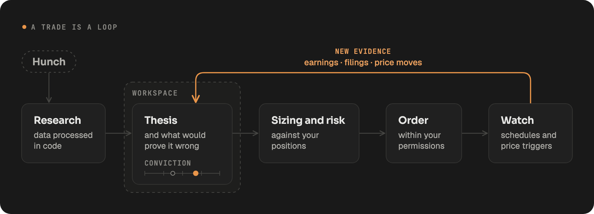

LangAlpha is an open-source harness for AI agents that work on financial markets. An agent researches a question, builds and maintains an investment thesis inside a workspace, produces deliverables such as reports, Excel models and dashboards, and can place orders in a brokerage account you connect, within permissions you set. You can use it on the hosted platform at [langalpha.ai](https://langalpha.ai) or run the same open-source code on your own machine.

## The idea behind it

Investment research is a loop, not a single question. You write down a thesis and what would prove it wrong, then each earnings print, filing and price move raises or lowers your conviction. LangAlpha keeps that loop in one place. A workspace holds the files, the agent's notes and its memory, so a session next week starts from what this week's session found instead of from a blank prompt.

## What the agent can do

- **Research with data in code.** The agent writes Python that calls market-data, fundamentals, SEC filing and web tools, so it can pull ten years of prices for a dozen tickers, transform them and chart them in one step. See [Plugins, MCP servers and programmatic tool calling](/concepts/plugins-mcp-ptc/).
- **Work as a team.** The main agent hands pieces of a question to subagents that run in parallel and report back findings. You can send a message at any time to redirect a running agent.
- **Hand back deliverables.** Built-in skills produce DCF and comps workbooks, initiation reports, earnings previews, morning notes, slide decks, PDFs and interactive dashboards. See [Skills](/concepts/skills/).
- **Keep watch.** Automations run on a schedule or when a price crosses a level, and the agent can schedule its own follow-up turns. See [Automations, wakeups and background commands](/concepts/automations-wakeups-commands/).
- **Trade within limits.** Brokerage connections carry only the capabilities you switch on, and each order follows one governed path with your approval by default. See [Brokerages and orders](/concepts/brokerages-and-orders/).
- **Show its sources.** A Sources panel lists every filing, page, data call and file the agent touched in a turn.

## The building blocks

| Term | What it is |
| --- | --- |
| Computer | The machine your workspaces run on: a cloud or Docker sandbox, or your own machine over SSH. |
| Workspace | A folder on a computer for one thesis, sector or portfolio, with its own files, notes and memory. |
| Thread | One conversation inside a workspace. |
| Turn | One run of the agent answering a message. |
| Analyst | The agent working inside a workspace. |
| Chief of Staff | The agent for work that belongs to no single workspace. It runs in a folder called Home and hands new research to a workspace's Analyst. |

[How it fits together](/concepts/overview/) explains how these relate.

## Where you use it

LangAlpha runs in the browser and in a desktop app for macOS, Windows and Linux. On the hosted platform you can also chat with it and receive results in Slack, Discord, Telegram, Feishu and iMessage.

It works with the model you already use: sign in with a Claude, ChatGPT or Grok subscription, connect a coding plan, bring an API key, or run a local model when you self-host. See [Models and your own keys](/concepts/models-and-keys/).

## Open source

The backend, agent, web app, desktop app and built-in plugins are in one repository under the Apache 2.0 license at [github.com/ginlix-ai/langalpha](https://github.com/ginlix-ai/langalpha). Every check an order passes is code you can read.

## Related

- [Hosted or self-hosted](/get-started/hosted-or-self-hosted/)
- [Self-hosting quickstart](/get-started/self-hosting-quickstart/)
- [How it fits together](/concepts/overview/)
- [Chief of Staff or Analyst?](/compare/chief-of-staff-or-analyst/)
