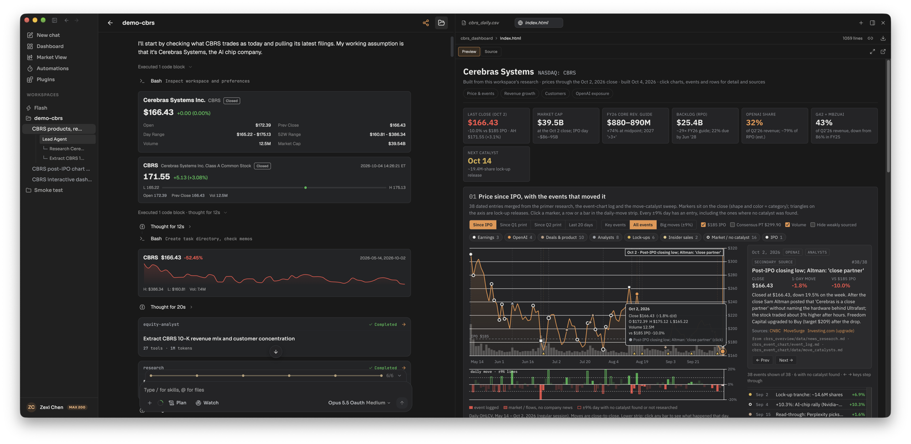

LangAlpha is a harness for AI agents that work on financial markets. You ask a question in a workspace, and an agent with its own computer reads filings, pulls market data, writes and runs code, and hands back a deliverable: a report, a workbook, a dashboard, or an order waiting for your approval. The workspace keeps the files, notes and memory, so the next session builds on the last.

## Start here

- [What is LangAlpha](/get-started/what-is-langalpha/): the product in one page.
- [Hosted or self-hosted](/get-started/hosted-or-self-hosted/): what changes between langalpha.ai and your own install.
- [Self-hosting quickstart](/get-started/self-hosting-quickstart/): `make config`, then `make up`.
- [How it fits together](/concepts/overview/): users, computers, workspaces, threads and turns.

## Questions people ask

- [Chief of Staff or Analyst?](/compare/chief-of-staff-or-analyst/) Which agent should take a request.
- [Automation or wakeup?](/compare/automation-or-wakeup/) Two ways to make the agent come back later.
- [Memory, memo or scratchpad?](/compare/memory-memo-or-scratchpad/) Where a piece of context belongs.
- [Skill, plugin or MCP server?](/compare/skill-plugin-or-mcp-server/) What to build when you extend LangAlpha.
- [Which computer should I use?](/compare/which-computer/) Docker, Daytona, E2B or your own machine.

## What you can do

- [Write an initiation report](/explore/initiation-report/) with a team of research subagents.
- [Prepare for earnings](/explore/earnings-preview/) and update the model after the print.
- [Build valuation models](/explore/valuation-models/) as real Excel workbooks.
- [Watch a stock and act on a price move](/explore/price-move-automation/).
- [Review your portfolio](/explore/portfolio-review/) against your investing profile.
- [Build dashboards and annotate charts](/explore/dashboards-and-charts/).
- [Get results in Slack and other chat apps](/explore/deliver-to-slack/).

## For agents

Every page is also served as Markdown at its URL plus `.md` (for example [/concepts/computers.md](/concepts/computers.md)). The whole site is indexed in [/llms.txt](/llms.txt), with the full text in [/llms-full.txt](/llms-full.txt).

:::caution
LangAlpha is software, not a financial adviser. Nothing it produces is investment advice. Agents act only within the permissions you grant, and you are responsible for every order placed on your accounts.
:::
